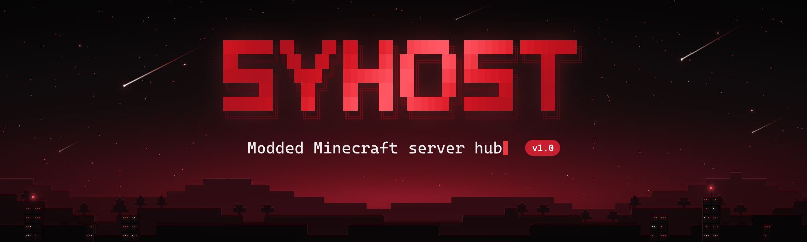
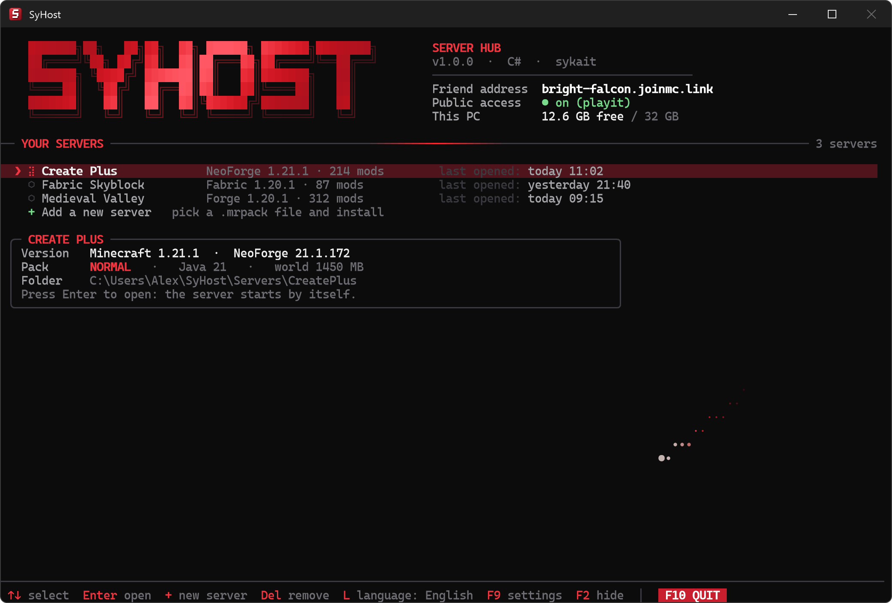
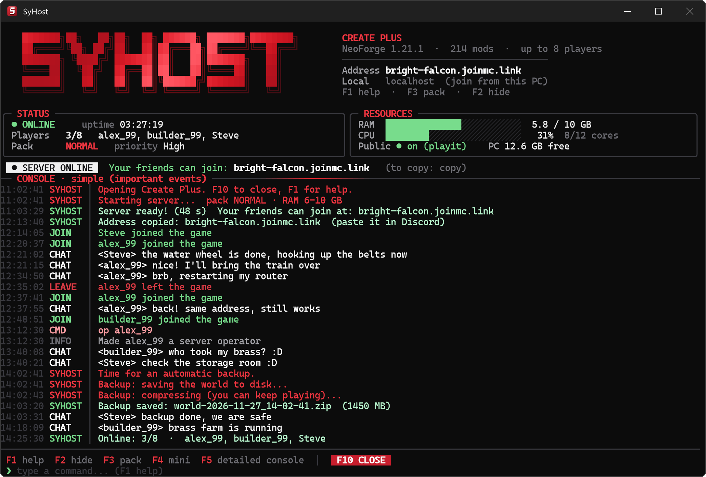
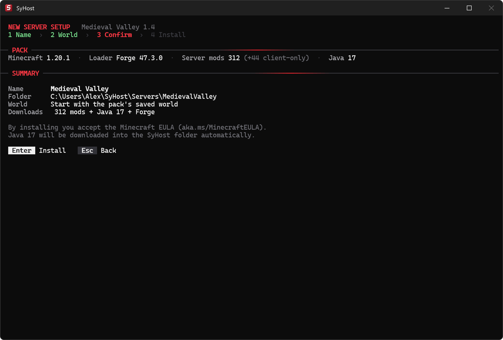
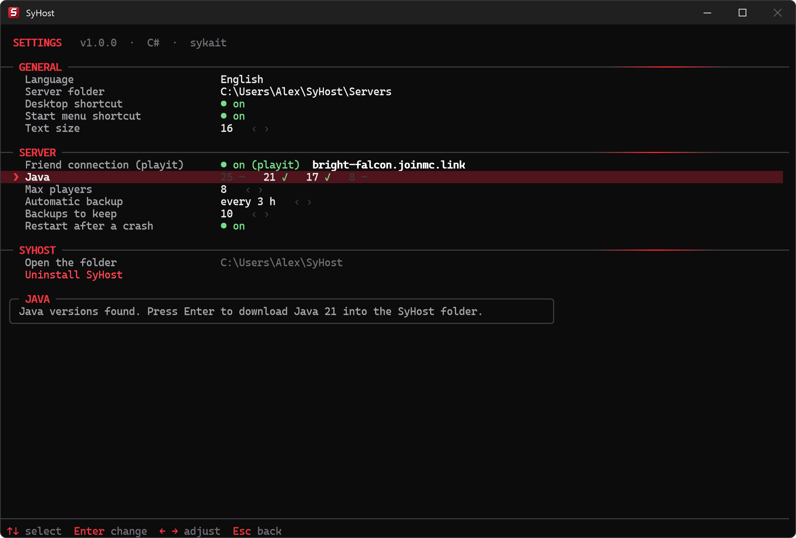
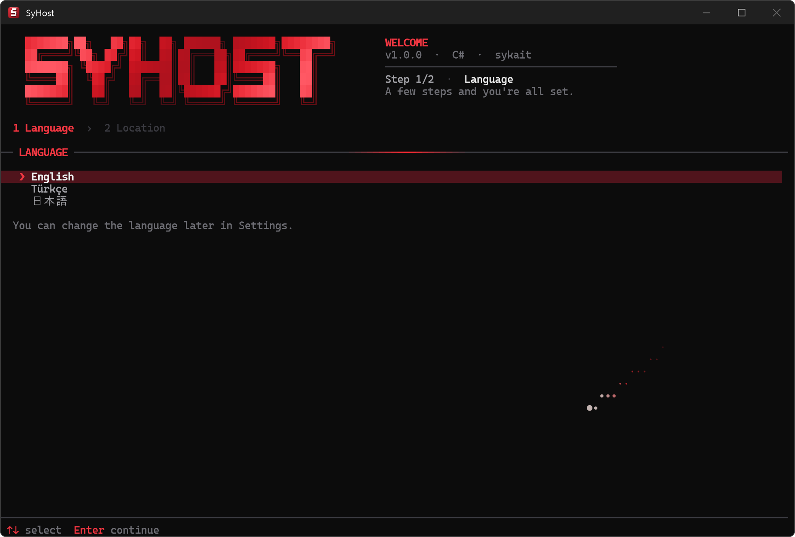
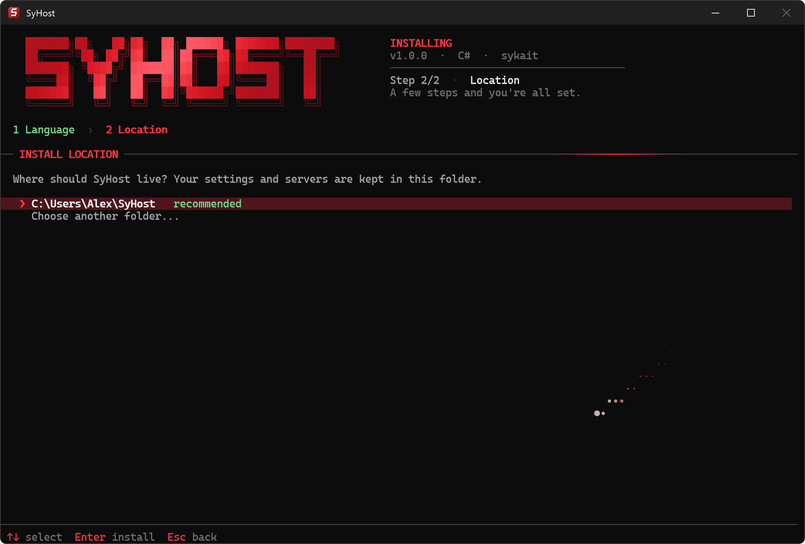
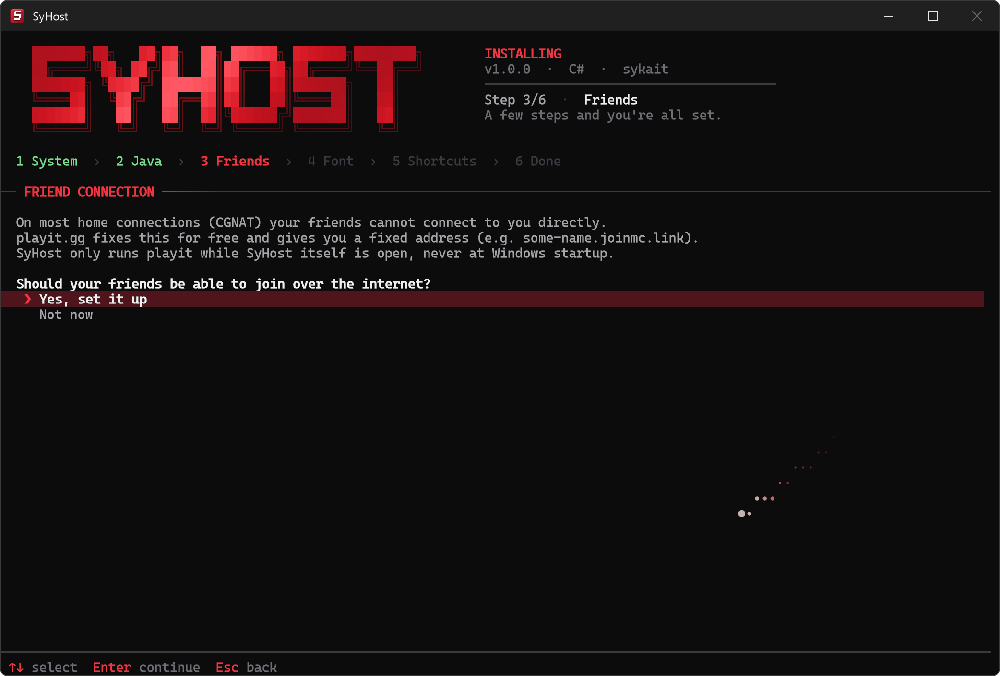
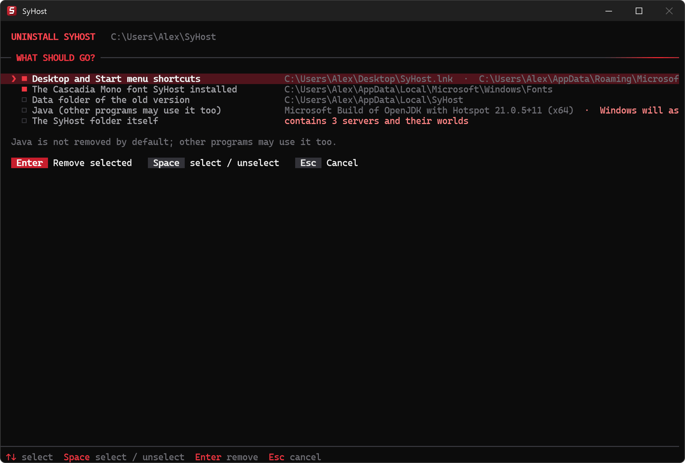
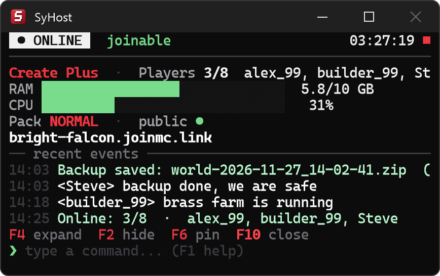

<p align="center">
  
</p>

<p align="center">
  <b>English</b> · <a href="docs/README.tr.md">Türkçe</a> · <a href="docs/README.ja.md">日本語</a>
</p>

# SyHost

**Run a modded Minecraft server from one friendly window.**
Pick a Modrinth modpack (`.mrpack`) and SyHost builds the server for you: the right Java, the mod loader, the
server-side mods, the pack's settings and even its world. Then start it with Enter, see who is online, let your
friends join over the internet and keep backups, all on one animated terminal screen.

> Windows 10 / 11 · NeoForge · Forge · Fabric · English, Türkçe, 日本語 · Made by [**sykait**](https://github.com/sykait)



## Contents

[Features](#features) · [Screenshots](#screenshots) · [Download](#download) · [First start](#first-start) ·
[The SyHost folder](#the-syhost-folder) · [Your first server](#your-first-server) · [The server screen](#the-server-screen) ·
[Friends over the internet](#friends-over-the-internet-playitgg) · [Java](#java) · [Backups](#backups) · [Settings](#settings) ·
[Updating](#updating) · [Uninstalling](#uninstalling) · [Coming from 0.5.0](#coming-from-050) ·
[Security and antivirus](#security-and-antivirus) · [FAQ](#faq) · [Building from source](#building-from-source) ·
[Project layout](#project-layout)

---

## Features

- **One file, nothing to install.** `SyHost.exe` sets itself up in a folder you choose and keeps everything there.
- **A server from a modpack in a few keys.** NeoForge, Forge and Fabric packs from [Modrinth](https://modrinth.com/modpacks).
  Java is downloaded for you when your PC doesn't have the right version.
- **Friends can join over the internet** with a free [playit.gg](https://playit.gg) address. playit only runs while SyHost is open.
- **Live status:** players, uptime, RAM and CPU, and a simple console with joins, chat and errors (F5 shows everything).
- **Performance packs** (Low / Normal / High), tuned to your PC's memory and cores the first time SyHost starts.
- **Automatic backups:** every 3 hours while the server is online, the newest 10 are kept.
- **Safe stop:** F10 → Enter warns the players, saves the world and stops the server. Even if the window gets closed
  while the server runs, the server finishes saving before it stops. Nothing keeps running after that.
- **Mini mode** in the corner of the screen (F4 or Ctrl+Alt+K), **hide and show** from anywhere (Ctrl+Alt+G), a tray icon.
- **Settings screen** (F9) and an **uninstaller** built in.
- **Three languages:** English, Türkçe, 日本語.

## Screenshots



<table>
  <tr>
    <td width="50%"><br><sub>Adding a server: the summary before installing</sub></td>
    <td width="50%"><br><sub>Settings (F9)</sub></td>
  </tr>
  <tr>
    <td><br><sub>First start: language</sub></td>
    <td><br><sub>First start: where SyHost lives</sub></td>
  </tr>
  <tr>
    <td><br><sub>Setup: connection for your friends</sub></td>
    <td><br><sub>Uninstall: you choose what goes</sub></td>
  </tr>
</table>

---

## Download

Get it from the **[Releases page](https://github.com/sykait/SyHost/releases/latest)**:

| File | Who it's for |
| --- | --- |
| **`SyHost-1.0.0.exe`** | **Everyone (recommended).** The main edition, written in C#. |
| `SyHost-Terminal-1.0.0.exe` | The same app as a PowerShell edition (it runs on the Windows PowerShell that comes with Windows), for people who like to read the scripts. |

Both editions look and work the same; only the version line on screen says `C#` or `Terminal`. They keep the same
files in the same folder, so you can switch later. Each one is a single file and there is nothing else to download.
The SHA-256 checksums of both are at the end of the release notes.

**You need:** 64-bit (x64) Windows 10 or 11 and an internet connection for the downloads. Modded servers like memory:
8 GB of RAM or more is recommended.

### "Windows protected your PC"

SyHost is not code-signed, so the first time you open it Windows SmartScreen may stop it. Click **More info → Run anyway**.
Your browser may also ask whether you want to keep the file. See [Security and antivirus](#security-and-antivirus) for
what SyHost does on your PC and what to do if a security program flags it.

---

## First start

Double-click the file you downloaded.

 

1. **Language.** The language of your Windows is preselected (Turkish and Japanese Windows get their language,
   everything else English). You can change it any time later.
2. **Where SyHost lives.** SyHost recommends `C:\Users\<name>\SyHost`. With **Choose another folder...** you can pick any
   folder you can write to. If that folder already has other files in it, SyHost makes a `SyHost` folder inside it,
   unless the folder is itself named `SyHost` or already holds a SyHost: then SyHost uses that folder directly
   (the SyHost there is updated, or only opened if it is newer).
   - A folder that syncs with **OneDrive** gets a warning: server files are big and change all the time, so a folder
     outside OneDrive is recommended. Press Enter again if you really want it there.
   - Folders you can't write to (for example `Program Files`) are refused.
   - **A folder of its own:** if the file you downloaded sits alone in an empty folder (not Downloads, the Desktop,
     Documents or a temporary folder), SyHost doesn't ask and installs right there. It still asks if a shortcut on
     this PC opens another SyHost, so you can update that one instead.
   - Opened straight from inside a zip or rar file, SyHost asks where to install.
3. SyHost copies itself into that folder and opens again from there; the file you downloaded isn't needed anymore.
   (In a folder of its own SyHost doesn't copy itself: it renames the download to `SyHost.exe`.)
4. A short setup follows: **System → Java → Friends → Font → Shortcuts → Done.**
   - **System** shows your Windows, RAM and cores (it warns below 8 GB of RAM).
   - **Java**: if your PC has no Java 21, download it now (about 50 MB, into the SyHost folder only) or later,
     when you add a server.
   - **Friends**: set up the connection for your friends (see [below](#friends-over-the-internet-playitgg)) or skip it for now.
   - **Font**: if Cascadia Mono is missing, SyHost installs it for your Windows user only (no admin rights needed),
     so the logo and the animations look right.
   - **Shortcuts**: on the Desktop and in the Start menu, both optional.

If you used SyHost 0.5.0 before, an **Old data** step comes first: see [Coming from 0.5.0](#coming-from-050).
If you close SyHost in the middle, the setup shows up again the next time you open it.

## The SyHost folder

```
C:\Users\<name>\SyHost\
├── SyHost.exe      the app: the only file you need to open
├── Servers\        your servers, one folder each
├── Data\           settings, server list, playit key, logs, downloaded Java and playit
└── App\            (Terminal edition only) the PowerShell app
```

- **Everything stays in this folder.** Outside of it SyHost only adds the shortcuts and the font (only if it had to
  install it); after a move from 0.5.0 it also leaves a short note in the old data folder. Servers you keep in
  another folder stay where you put them.
- **Portable.** You can move or rename the folder whenever you like (close SyHost first). Open `SyHost.exe` from its
  new place once and it repairs its Desktop and Start-menu shortcuts. Servers inside the folder move with it.
  Keep it somewhere you can write to: opened from a folder like `Program Files`, SyHost only shows a warning that
  tells you to move the whole SyHost folder (with `Servers` and `Data`).
- **The Terminal edition needs a local drive.** Windows PowerShell may refuse to run scripts from a network share,
  so keep that edition's folder on a drive of this PC (the main edition doesn't mind).
- In Explorer the folders get SyHost icons, and the `Servers` and backup folders show their names in your language.
- `Data\playit.toml` is the secret key of your playit connection. Don't share it.

## Your first server

1. Download a modpack from [Modrinth](https://modrinth.com/modpacks) as an **`.mrpack`** file.
2. In the main menu choose **Add a new server** (or press `+`) and pick the file.
3. Give the server a name. If the pack comes with a ready-made world, choose it or a brand new world.
4. Check the summary and press **Enter**. By installing you accept the
   [Minecraft EULA](https://aka.ms/MinecraftEULA); SyHost says so on the summary.
5. SyHost now:
   - creates the server folder (in `Servers`, unless you chose another server folder in Settings),
   - downloads the Java this pack needs if your PC doesn't have it ([more](#java)),
   - installs NeoForge or Forge with their official installer, or downloads Fabric's server launcher,
   - downloads the mods that run on the server (mods marked client-only are skipped) and checks every file
     against the checksums in the pack,
   - copies the pack's config files and, if you chose it, its world,
   - writes `server.properties` (port 25565, the max players from Settings) and, unless the pack brings its own,
     adds SyHost's icon for Minecraft's server list.
6. Press **Enter** to open the server. It is ready when the bar at the top says **SERVER ONLINE**.

NeoForge, Forge and Fabric packs are supported. Quilt packs are not supported yet.

## The server screen

At the top you see the status, the players, the active performance pack, the RAM and CPU the server uses, whether
your friends can reach it and how much memory your PC has free. The bar under it says **SERVER ONLINE** and shows
the address for your friends. The console shows only what matters (joins, leaves, chat, errors and SyHost's own
messages); **F5** switches to every log line. Type commands at the bottom.

### Keys

| Key | What it does |
| --- | --- |
| **↑ ↓**, **Enter** | Main menu: choose a server and open it (the server starts by itself) |
| **+** | Main menu: add a new server |
| **Del** | Main menu: remove a server from the list (its files stay on the disk) |
| **L** | Main menu: change the language |
| **F9** | Main menu: settings |
| **F1** | Server: how to use it (help) |
| **F2** | Hide the window. The server keeps running |
| **F3** | Server: choose a performance pack |
| **F4** | Server: mini mode in the corner of the screen / full size |
| **F5** | Server: simple / detailed console |
| **F6** | Server: pin or unpin the mini window on top of other windows (pinned by default) |
| **F10** | Main menu: quit. Server: close (see below) |
| **Ctrl+Alt+K** | Mini / full size from anywhere, even in the game (while a server is open) |
| **Ctrl+Alt+G** | Hide / show SyHost, from anywhere |
| **PgUp PgDn Home End** | Server: scroll the console |
| **↑ ↓**, **Tab** | Server: earlier commands, complete commands and player names |

**Closing.** F10 on the server screen asks what to do: **Enter** warns the players, saves the world, stops the
server and goes back to the main menu; **K** does the same and then quits SyHost; **Esc** cancels. If the server
does not stop within 60 seconds, SyHost stops it by force. If the window is closed some other way while the server
runs (from the taskbar, or because you sign out), SyHost still tells the server to stop, and the server finishes
saving the world by itself.

**Mini mode** (F4) is a small window in the corner of the screen with the status, the players, RAM and CPU and the
latest events. It is pinned on top of other windows, so you can see it while you play; F6 unpins it and pins it again.



**Hide** (F2) takes SyHost off the screen while the server keeps running. Ctrl+Alt+G or the tray icon next to the
clock brings it back. The tray icon's menu can also restart the server or quit SyHost.

**If the server crashes,** SyHost starts it again after 10 seconds (Settings → Restart after a crash). After three
crashes within 10 minutes it stops trying, so you can look at the details with F5.

### Commands

Type in the server screen and press Enter:

| Command | What it does |
| --- | --- |
| `start` · `stop` · `restart` | Start, stop or restart the server |
| `pack low` · `pack normal` · `pack high` | Change the performance pack (`pack` alone opens the picker) |
| `backup` | Back up the world now |
| `players` | Who is online |
| `address` · `copy` | Show the addresses / copy the friend address to the clipboard |
| `folder` | Open the server folder |
| `detail` · `simple` | Detailed or simple console |
| `mini` · `full` · `pin` · `hide` | Window modes (like F4, F6, F2) |
| `clear` | Clear the console |
| `force` | Stop a server that doesn't respond |
| `menu` · `exit` | Back to the main menu / quit SyHost (the server stops safely) |

Anything else goes straight to Minecraft: `op name`, `kick name`, `say hello`, `time set day`…
The Turkish command names (`baslat`, `durdur`, `yedek`…) work in every language.

**Performance packs** (F3) set how much RAM, how many CPU cores and which priority the server gets: **Low** while you
play a heavy game yourself, **Normal** for everyday use, **High** for huge factories and fast exploring. Cores and priority
change at once; a new RAM size needs a `restart`.

---

## Friends over the internet (playit.gg)


Most home internet connections (CGNAT) don't let your friends connect to your PC directly.
[playit.gg](https://playit.gg) solves this for free and gives you a fixed address like `some-name.joinmc.link`.

**Set it up** in the **Friends** step of the first start, or later in **Settings → Friend connection (playit)**:

1. SyHost downloads playit into its own folder (`Data\tools\playit`). If SyHost 0.5.0's playit is still in
   `Program Files`, that one is used instead.
2. playit.gg opens in your browser: create a free account or sign in, then approve this PC.
3. The playit tunnel page opens: **Add Tunnel → Minecraft Java → Continue →** region **Automatic (Free) → Create Tunnel**.
   If you use the Simple Voice Chat mod, also create a **MC: Simple Voice Chat** tunnel.
4. Paste the address(es) into SyHost. The voice chat address is written into the mod's settings for you.

**playit only runs while SyHost is open.** SyHost starts it and stops it together with itself. It isn't a Windows
service and it doesn't start with Windows.

**Inviting a friend:** type `copy` in the server screen and paste the address in Discord. Your friend opens the
**same modpack in the same version** (with the Modrinth App, Prism Launcher…), goes to **Multiplayer → Add Server**
and pastes the address.

Without playit you can join from your own PC with `localhost`, and players on your home network can join with your
PC's local IP address. If your internet connection has a public IP and you forward TCP port 25565 to your PC,
you don't need playit either.

## Java

- SyHost first looks for a Java already on your PC (Microsoft Build of OpenJDK or Eclipse Temurin in `Program Files`).
- If the right version is missing when you add a server, it downloads **Eclipse Temurin** (from Adoptium) into
  `Data\tools\java-<version>` inside the SyHost folder. It checks the download against Adoptium's SHA-256 checksum
  when that checksum is available, and `java -version` has to run before SyHost uses it.
  No installer, no admin rights, nothing outside the folder.
- Each server gets the version its Minecraft needs: 1.20.5 and newer → Java 21, 1.17 to 1.20.4 → 17, older → 8,
  Minecraft 26.x → 25.
- **Settings → Java** shows which versions SyHost can use and downloads Java 21 with Enter.

## Backups

- **Automatic** every 3 hours while a server is online (Settings → Automatic backup: 1 to 24 hours, or 0 for off).
- **Any time:** type `backup`.
- The world is saved to disk first and then zipped while you keep playing:
  `<server folder>\yedekler\world-2026-11-27_14-02-41.zip`. For servers in the SyHost folder, Explorer shows
  `yedekler` as **Backups**.
- Only the newest **10** are kept (Settings → Backups to keep).
- To restore one: stop the server, rename its `world` folder, make a new empty `world` folder and unzip the backup into it.

## Settings

Press **F9** in the main menu. Every change is saved at once.

| Setting | What it does |
| --- | --- |
| Language | English, Türkçe or 日本語. Folder names in Explorer follow it |
| Server folder | Where new servers are installed (default: `Servers` in the SyHost folder) |
| Desktop shortcut · Start menu shortcut | On or off |
| Text size | The size of the text; the window grows or shrinks with it |
| Friend connection (playit) | Set up the connection for your friends or link it again |
| Java | The Java versions SyHost found; Enter downloads Java 21 into the SyHost folder |
| Max players | For servers you install from now on |
| Automatic backup · Backups to keep | How often (0 = off) and how many |
| Restart after a crash | On or off |
| Open the folder | Opens the SyHost folder in Explorer |
| Uninstall SyHost | See [Uninstalling](#uninstalling) |

## Updating

1. Download the new SyHost from the [Releases page](https://github.com/sykait/SyHost/releases/latest).
2. Close SyHost if it is open.
3. Open the new file. On the folder step choose your SyHost folder. SyHost offers the one your shortcuts open
   (**Update the SyHost on this PC**) and says "SyHost is already here; it will be updated and opened".
4. SyHost replaces `SyHost.exe` in that folder and opens it. Your servers, worlds, settings, Java and playit
   connection stay as they are.

If you choose **Update the SyHost on this PC** and that SyHost is already newer, it is only opened, not replaced.

## Uninstalling


Open **Settings → Uninstall SyHost**. SyHost lists everything it (or SyHost 0.5.0) left **outside** its folder, one
line each, and you choose with **Space**:

- the Desktop and Start-menu shortcuts and, if SyHost installed it, its font for your user. These are selected.
- what SyHost 0.5.0 left on the PC: its data folder, its program folder, playit in `Program Files`, the font it put
  into Windows, and Java installed on the PC (Microsoft OpenJDK and Eclipse Temurin 8, as 0.5.0 installed them).
  None of these is selected. **Java is never selected by default**, because other programs may use it.
  Lines marked "Windows will ask for permission" need admin rights. The new SyHost still uses that playit, font
  and Java while they are there: read [Coming from 0.5.0](#coming-from-050) before you remove them.
- **the SyHost folder itself**, with your servers and worlds inside. Its line says how many servers go with it: every
  folder in `Servers` counts, also servers you removed from the list. It is not selected, and if you select it,
  SyHost asks you to press Enter a second time. When SyHost closes, it deletes everything inside the folder and then
  shows the folder in Explorer: delete what is left there (`SyHost.exe`, in the Terminal edition also its `App`
  folder, and any file another program still had open). If the SyHost folder is a link to another place (a junction,
  or a drive mounted into a folder), this line is not offered.

**Enter** removes what is selected. The last screen only offers **Close SyHost**, so SyHost closes at the end.
If you keep the folder, SyHost shows it in Explorer at the end so you can delete it whenever you want (with nothing
selected, Enter goes straight to that screen). Servers outside the SyHost folder are never touched.

## Coming from 0.5.0

- Download the new SyHost and open it as described in [First start](#first-start). The old one-line PowerShell
  installer is not used anymore.
- SyHost 0.5.0 kept its data in `%LOCALAPPDATA%\SyHost`. The first time the new SyHost starts in its folder, it
  **copies** your settings, your server list and your playit connection into its `Data` folder, **once**.
- **The old folder is not deleted.** SyHost leaves a short note in it. You can remove it later with
  Settings → Uninstall SyHost → *Data folder of the old version*. That screen already selects the Desktop and
  Start-menu shortcuts (and SyHost's own font, if it installed one): if you only want to clean up after 0.5.0,
  unselect those lines with Space first. Enter removes what is selected, and at the end SyHost closes
  (**Close SyHost**).
- **Your servers stay where they are** (for example in `%USERPROFILE%\SyHost Sunuculari`) and keep working from there.
  New servers go into `Servers` in the SyHost folder; if you had picked your own server folder in 0.5.0, that one is
  kept (Settings → Server folder).
- **What 0.5.0 installed on the PC is still used** while it is there, so it is not just a leftover:
  - **playit** in `C:\Program Files\playit_gg`, as long as SyHost has no playit of its own in `Data\tools\playit`.
    If you remove it, link playit again in **Settings → Friend connection (playit)**; SyHost then downloads playit
    into its folder.
  - **Java** in `Program Files`. If you remove it, servers that used it don't start (SyHost says "Java 21 not found",
    for example) until SyHost has downloaded that Java into its folder: **Settings → Java** downloads Java 21, and
    adding a server downloads the Java its pack needs.
  - **the Cascadia Mono font** in `C:\Windows\Fonts`. SyHost installs its own copy for your user only during the
    setup, so if you remove this one later, the logo and the animations may not look right.
- The Shortcuts step replaces the old shortcuts with ones that open the new SyHost.
- If you later open another, separate copy of SyHost, it asks before copying the old data again (two copies sharing
  one playit connection would get in each other's way).

---

## Security and antivirus

SyHost is an ordinary program and tries to behave like one:

- Everything it needs stays in its own folder (see [The SyHost folder](#the-syhost-folder)). Opened outside a SyHost
  folder (the first start, or an update from Downloads), the Terminal edition runs from a temporary copy in
  `%TEMP%\SyHost-Terminal-…`, which is deleted when SyHost closes. SyHost asks for admin rights only when you choose
  to remove something the old 0.5.0 setup installed for the whole PC (Settings → Uninstall SyHost): for its font the
  Windows prompt names SyHost itself, for playit and Java it is their own Windows Installer.
- It never opens a hidden PowerShell or cmd window and never passes encoded commands. It never builds code from text
  while it runs, never removes the "downloaded from the internet" mark from files and never deletes itself through a
  helper program. The programs it runs for you (your server's Java, the mod loader's installer, playit, and in the
  Terminal edition Windows' `taskkill` to stop a stuck installer) run without a window of their own; your server's
  console is shown on SyHost's screen. Uninstalling empties the folder while SyHost is still open; you delete the
  rest in Explorer.
- It downloads Java from Adoptium, playit from playit's GitHub releases and the mod loader from NeoForge, Forge or
  Fabric; the mod loader then gets Minecraft and its libraries from Mojang. Mods come from the addresses in the
  `.mrpack` you open (for Modrinth packs: Modrinth's CDN, GitHub or GitLab) and are kept only if they match the SHA-1
  or SHA-512 the pack lists. Java is checked against Adoptium's SHA-256 whenever Adoptium returns one. A downloaded
  playit is kept only if it matches the SHA-256 GitHub lists for it (when GitHub lists one) and Windows finds its
  signature valid. A playit that SyHost 0.5.0 installed in `Program Files` is used as it is.
- Nothing starts with Windows. playit runs only while SyHost is open. If Windows or a security program blocks playit,
  SyHost doesn't keep retrying: the console says so, and **Settings → Friend connection (playit) → Continue** tries
  again.

SyHost is not code-signed yet, so SmartScreen may warn the first time and a security program may be extra careful with
a file it has never seen. If yours flags SyHost:

1. Check that the file is the real one: its SHA-256 must match the value at the end of the release notes
   (in PowerShell: `Get-FileHash .\SyHost-1.0.0.exe`).
2. Report it to the vendor as a false positive. For Microsoft Defender:
   [microsoft.com/wdsi/filesubmission](https://www.microsoft.com/wdsi/filesubmission) ("incorrectly detected").
3. Open an issue on GitHub so others know.

Don't turn your antivirus off or add an exclusion for SyHost.

For developers: `tests\av\Test-Lint.ps1` (runs in CI) fails when a pattern that security programs associate with
malware comes back, and `tests\av\Test-Defender.ps1` checks the scripts and both exes with the local Microsoft Defender
before a release.

## FAQ

**Do I need playit?**
No. Without it you can play on your own PC (`localhost`) and with people on your home network. You need it when
friends join over the internet and your connection is behind CGNAT, which is very common.

**Will it slow down my PC?**
SyHost itself is light. The server takes what its performance pack allows (F3): pick **Low** while you play a heavy
game, **Normal** otherwise.

**Can I run two servers at the same time?**
No, one at a time. SyHost won't start a second server while another one is running.

**Does SyHost need admin rights?**
No. Java, playit and the font all go into your own user's space. Only removing things the old 0.5.0 setup installed
for the whole PC asks for permission.

**Where are my files?**
In the SyHost folder: the servers in `Servers` (or the server folder you chose in Settings), everything else in the
`Data` folder, backups in each server's `yedekler` folder. Settings → Open the folder takes you there.

**Which modpacks work?**
Modrinth `.mrpack` packs for NeoForge, Forge and Fabric. Java 8, 17, 21 or 25 is downloaded when a pack needs it
and your PC doesn't have it.

**Which edition should I take?**
`SyHost-1.0.0.exe`. The Terminal edition is the same app for people who like to read the PowerShell scripts.

**Mac or Linux?**
Windows 10 and 11 only.

---

## Building from source

You need Windows, the [.NET 10 SDK](https://dotnet.microsoft.com/download) and the Visual Studio C++ build tools
(for the single-file NativeAOT build), plus Windows PowerShell 5.1, which comes with Windows.

```powershell
build\Build.ps1                       # quick compile check (Debug)
build\Build.ps1 -Publish              # dist\SyHost.exe, the main edition as one file
build\Build.ps1 -Publish -Terminal    # also dist\SyHost-Terminal.exe, the Terminal edition
tests\parity\Run-Parity.ps1           # builds, then compares the two editions screen by screen
build\Render-Screens.ps1              # draws the screenshots in docs\images\screens again
```

**Two editions, one screen.** SyHost began as a PowerShell script. The **main edition** (`src/SyHost`) is its C#
port, built with .NET 10 NativeAOT into a single `SyHost.exe`, and it is the reference. The **Terminal edition**
(`legacy/src`) is the PowerShell app, brought up to the same features; its launcher exe carries the scripts inside.

**The parity test** keeps them identical. Each scenario in `tests/parity/scenarios` describes one moment of the app:
the screen, the language, the servers, the time (frozen), even keys to press. Both editions draw that moment as one
text frame, colors included (`SyHost.exe --frame` and `SyHost.ps1 -TestFrame`), and the two frames must match byte for
byte. CI runs it for every push to `main` and every pull request. The screenshots on this page are drawn from such
scenarios (`docs-*.json`) by `build\Render-Screens.ps1`.

**Texts** come in three languages. The base table is in `legacy/src/Lang.ps1` and `src/SyHost/App/Lang.Table.cs`,
kept the same by hand. The texts of the new screens are written in C# (`src/SyHost/App/Lang.Screens.cs`,
`src/SyHost/Setup/Lang.Portable.cs`, `src/SyHost/Core/Installer.cs`, `src/SyHost/Core/Tray.cs`), and
`build\Sync-Lang.ps1` copies them to `legacy/src/Lang.Screens.ps1` (`build\Sync-Lang.ps1 -Check` only checks that
the copy is up to date).

## Project layout

```
SyHost/
├── src/
│   ├── SyHost/             the main edition (C#, .NET 10, NativeAOT)
│   │   ├── App/            the screens: main menu, server, new server, first start, settings, uninstall; texts
│   │   ├── Core/           Windows layer, server installer, Java, tray icon, settings files
│   │   ├── Setup/          the SyHost folder, shortcuts, font, moving old data, uninstall, folder icons
│   │   └── Assets/         app and folder icons
│   └── SyHost.Terminal/    the Terminal edition's launcher (one exe that carries the PowerShell app)
├── legacy/                 the Terminal edition (Windows PowerShell 5.1)
│   ├── src/                SyHost.ps1 and its parts, C# helpers, texts
│   ├── config/             default settings (both editions)
│   └── fonts/              Cascadia Mono (SIL Open Font License 1.1)
├── build/                  Build.ps1, Sync-Lang.ps1, Render-Screens.ps1, Build-Banner.ps1, Build-Icons.ps1
├── tests/parity/           Run-Parity.ps1 and the scenarios
├── docs/                   this page in Türkçe and 日本語, images, release notes
└── .github/workflows/      CI and releases
```

---

## How it was made

SyHost is designed and directed by **sykait**: the features, the flow and the look.
The code was written together with AI coding tools.

## License & credit

SyHost is **source-available**: you can view it, download it and use it personally.
**If you build something with it and share it, you must give credit:**

> This project is based on **SyHost** by **sykait** — https://github.com/sykait/SyHost

Selling it or using it commercially without written permission is not allowed. Details: [LICENSE.md](LICENSE.md).
The Cascadia Mono font is licensed under the SIL Open Font License 1.1 ([legacy/fonts/OFL.txt](legacy/fonts/OFL.txt)).

Minecraft is a trademark of Mojang Studios. SyHost is not affiliated with Mojang or Microsoft.
