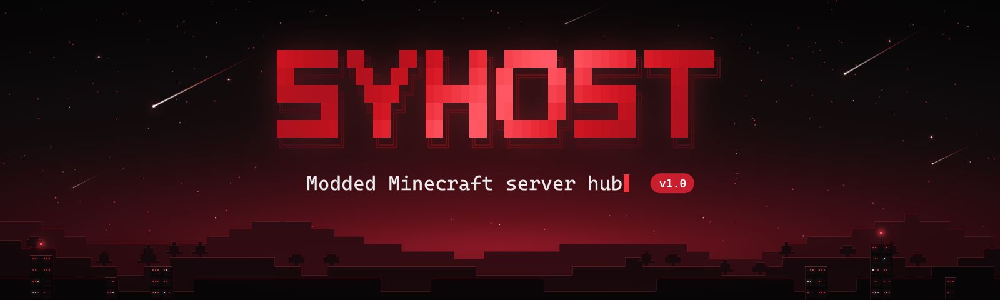
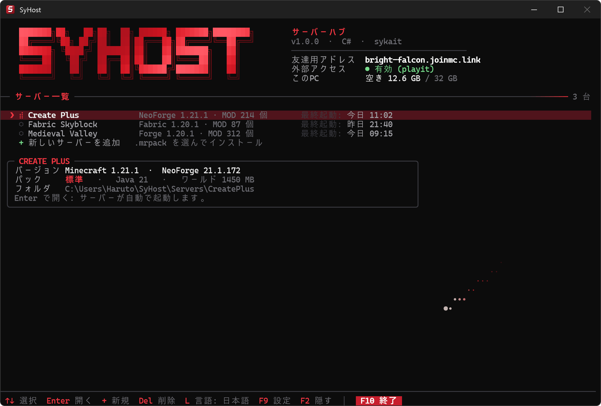
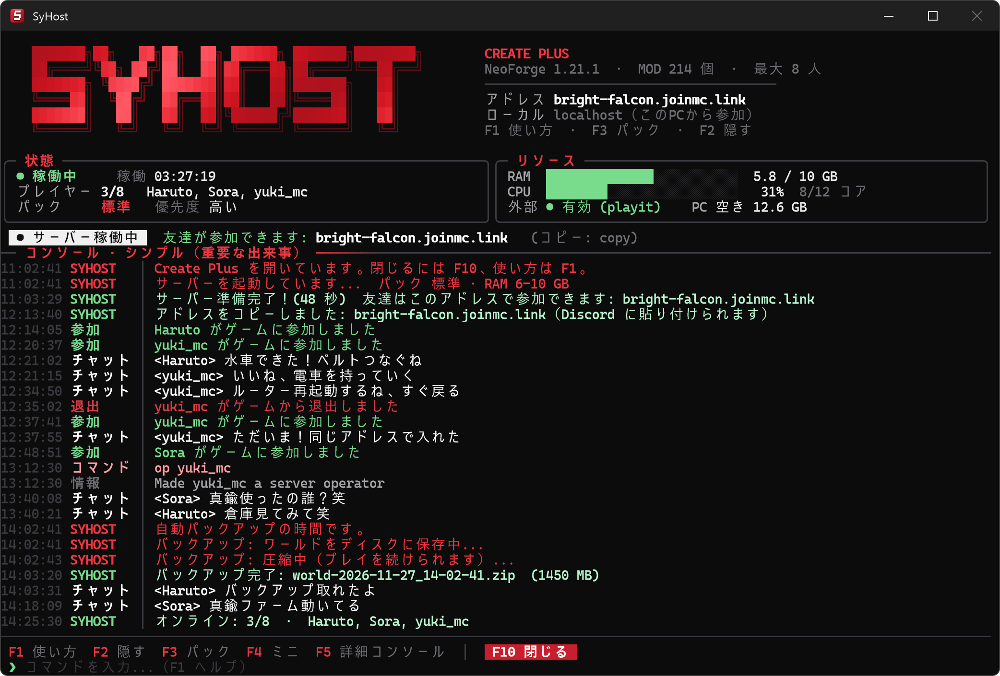
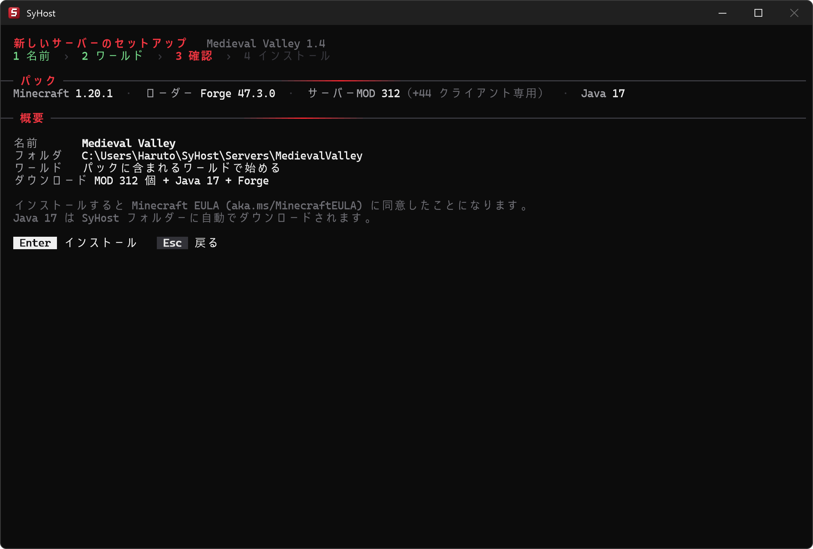
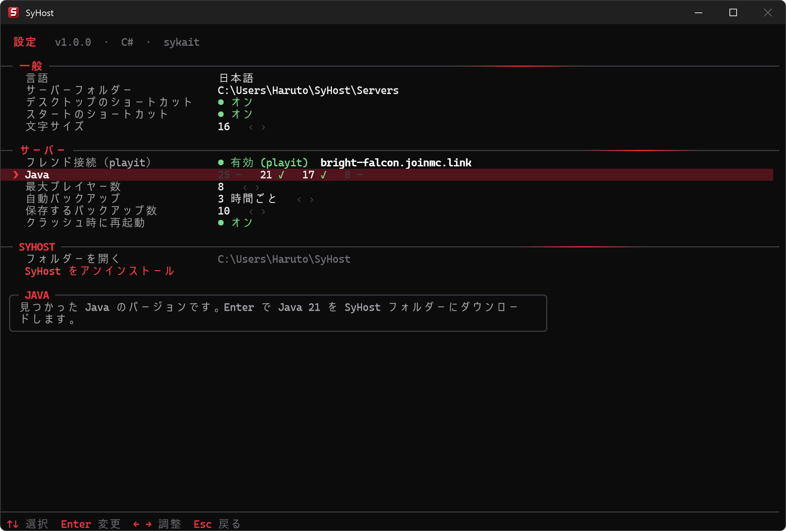
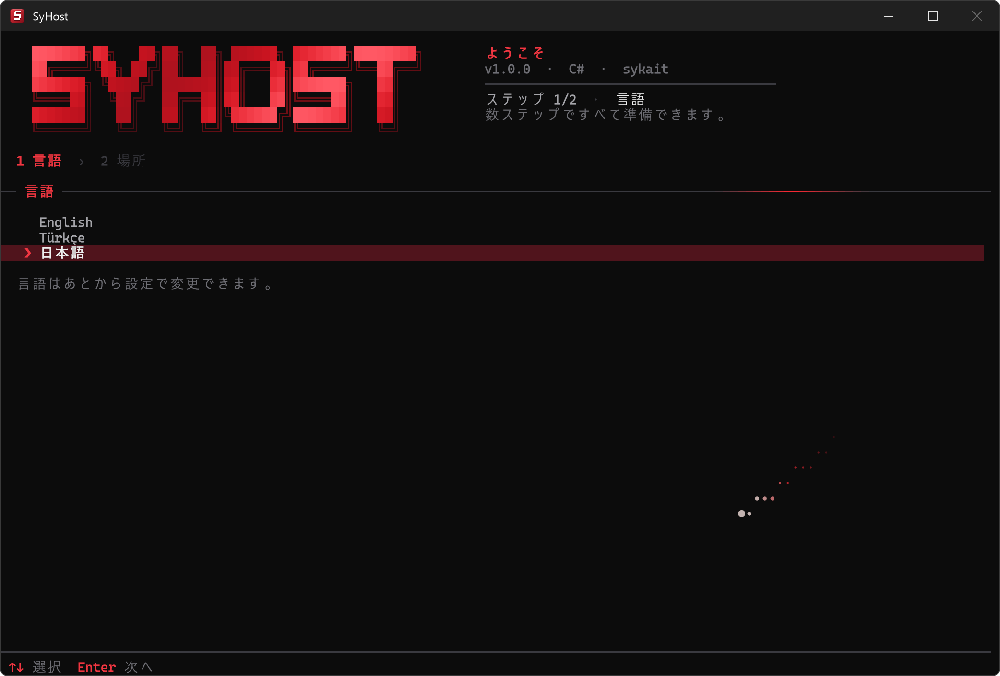
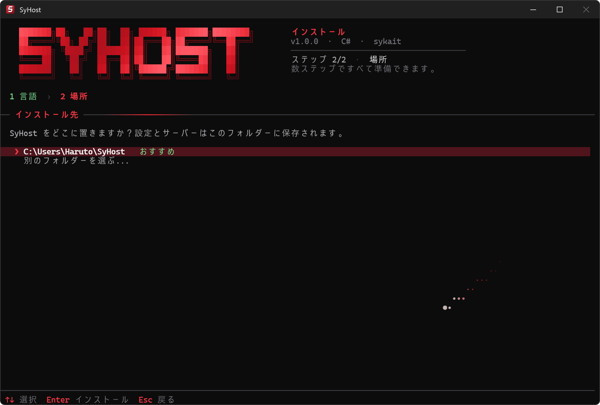
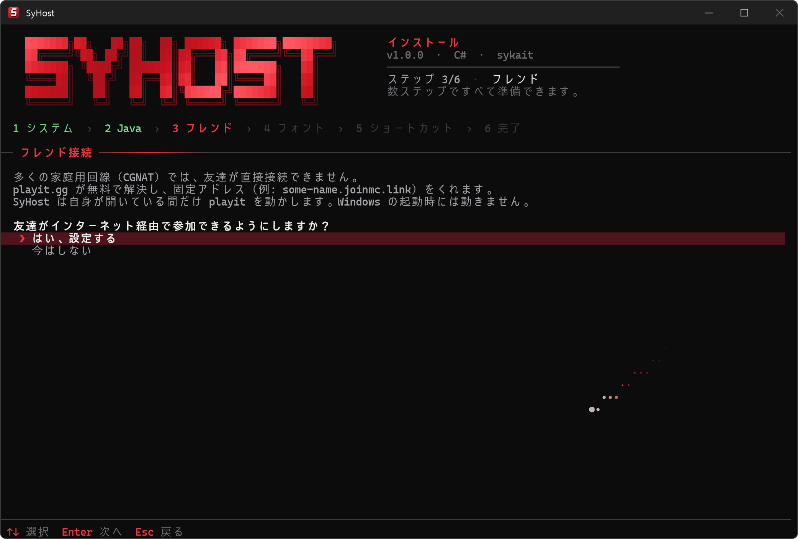
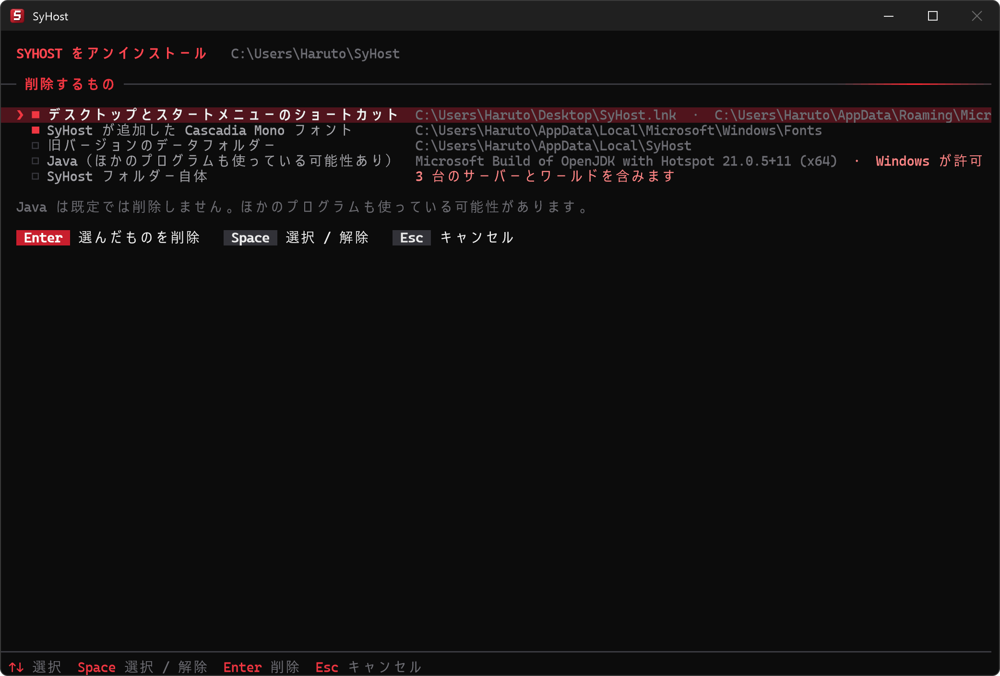
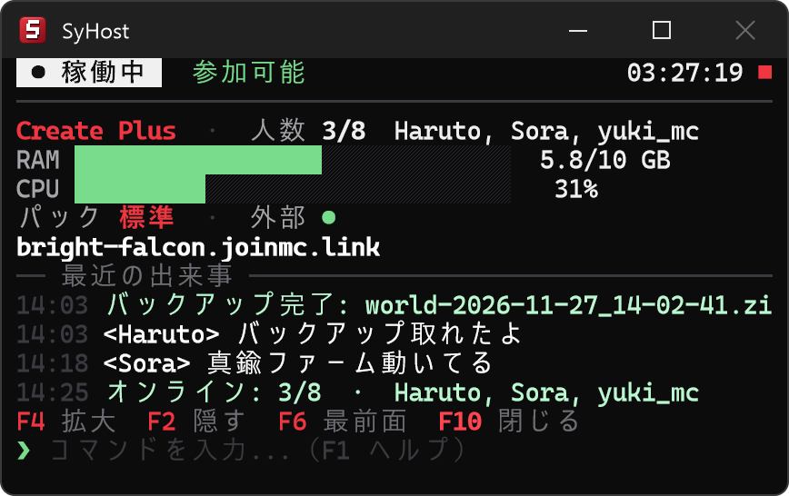

<p align="center">
  
</p>

<p align="center">
  <a href="../README.md">English</a> · <a href="README.tr.md">Türkçe</a> · <b>日本語</b>
</p>

# SyHost

**MOD入り Minecraft サーバーを、ひとつのウィンドウで立てて、動かして、管理。**
Modrinth の Modpack（`.mrpack`）を選ぶだけで、必要な Java、MOD ローダー、サーバー用の MOD、パックの設定、
パックに入っているワールドまで SyHost が用意します。あとは Enter でサーバーを起動し、誰が遊んでいるかを確認し、
友達をインターネット経由で招待し、バックアップは自動で。すべてアニメーション付きのターミナル画面ひとつで完結します。

> Windows 10 / 11 · NeoForge · Forge · Fabric · English, Türkçe, 日本語 · 作者: [**sykait**](https://github.com/sykait)



## 目次

[特長](#tokucho) · [スクリーンショット](#screenshots) · [ダウンロード](#download) · [初回起動](#first-start) ·
[SyHost フォルダー](#folder) · [最初のサーバー](#first-server) · [サーバー画面](#server-screen) ·
[友達とインターネットで遊ぶ](#friends) · [Java](#java) · [バックアップ](#backups) · [設定](#settings) ·
[アップデート](#update) · [アンインストール](#uninstall) · [0.5.0 からの移行](#from-050) ·
[セキュリティとウイルス対策ソフト](#security) · [よくある質問](#faq) · [ソースからビルド](#build) ·
[プロジェクト構成](#layout)

---

<a id="tokucho"></a>
## 特長

- **ファイルはひとつ、インストール作業は不要。** `SyHost.exe` が選んだフォルダーに自分を配置し、すべてをそこにまとめます。
- **数回のキー操作で Modpack からサーバーを作成。** [Modrinth](https://modrinth.com/modpacks) の NeoForge・Forge・Fabric パックに対応。
  PC に合う Java がなければ SyHost がダウンロードします。
- **友達はインターネット経由で参加できます。** [playit.gg](https://playit.gg) の無料の固定アドレスを使います。
  playit が動くのは SyHost が開いている間だけです。
- **リアルタイムの状態表示:** プレイヤー、稼働時間、RAM と CPU、そして参加・チャット・エラーだけを表示するシンプルな
  コンソール（F5 ですべてのログ）。
- **パフォーマンスパック**（低 / 標準 / 高）は、初回起動時に PC のメモリとコア数に合わせて調整されます。
- **自動バックアップ:** サーバー稼働中は 3 時間ごと。最新の 10 個を保存します。
- **安全な終了:** F10 → Enter でプレイヤーに知らせ、ワールドを保存してからサーバーを停止。サーバーの稼働中に
  ウィンドウが閉じられても、サーバーは保存を終えてから停止します。そのあとに動き続けるものはありません。
- 画面の隅に置ける**ミニモード**（F4 か Ctrl+Alt+K）、どこからでも使える**非表示 / 表示**（Ctrl+Alt+G）、
  タスクトレイのアイコン。
- **設定画面**（F9）と、アプリ内からの**アンインストール**。
- **3 言語:** English・Türkçe・日本語。

<a id="screenshots"></a>
## スクリーンショット



<table>
  <tr>
    <td width="50%"><br><sub>サーバーの追加: インストール前の確認</sub></td>
    <td width="50%"><br><sub>設定（F9）</sub></td>
  </tr>
  <tr>
    <td><br><sub>初回起動: 言語</sub></td>
    <td><br><sub>初回起動: SyHost の置き場所</sub></td>
  </tr>
  <tr>
    <td><br><sub>セットアップ: フレンド接続</sub></td>
    <td><br><sub>アンインストール: 削除するものを選べます</sub></td>
  </tr>
</table>

---

<a id="download"></a>
## ダウンロード

**[Releases ページ](https://github.com/sykait/SyHost/releases/latest)** から入手できます。

| ファイル | 対象 |
| --- | --- |
| **`SyHost-1.0.0.exe`** | **すべての方へ（おすすめ）。** C# で書かれたメイン版です。 |
| `SyHost-Terminal-1.0.0.exe` | 同じアプリの PowerShell 版（Windows に標準で入っている PowerShell で動きます）。スクリプトを読んでみたい方向けです。 |

どちらも見た目も動きも同じで、違うのは画面のバージョン行に `C#` か `Terminal` と出ることだけです。
同じフォルダーで同じファイルを使うので、あとから乗り換えることもできます。どちらもファイルはひとつだけで、
ほかにダウンロードするものはありません。両方の SHA-256 チェックサムはリリースノートの最後に載っています。

**必要なもの:** 64 ビット（x64）版の Windows 10 または 11 と、ダウンロード用のインターネット接続。
MOD入りサーバーはメモリを多く使うため、8 GB 以上の RAM をおすすめします。

### 「Windows によって PC が保護されました」と表示されたら

SyHost にはコード署名がないため、初回は Windows SmartScreen に止められることがあります。
**詳細情報 → 実行** を選んでください。ブラウザーがファイルを保存するか確認してくる場合もあります。
SyHost が PC で何をするか、セキュリティソフトに検出されたときにどうすればよいかは
[セキュリティとウイルス対策ソフト](#security) を参照してください。

---

<a id="first-start"></a>
## 初回起動

ダウンロードしたファイルをダブルクリックします。

 

1. **言語。** Windows の言語があらかじめ選ばれています（日本語やトルコ語の Windows ではその言語、それ以外は英語）。
   あとからいつでも変更できます。
2. **SyHost の置き場所。** おすすめは `C:\Users\<ユーザー名>\SyHost` です。**別のフォルダーを選ぶ...** を使えば、
   書き込める好きなフォルダーを選べます。ほかのファイルがすでに入っているフォルダーを選ぶと、その中に `SyHost`
   フォルダーが作られます。ただし、フォルダー名がもともと `SyHost` の場合や、中に SyHost がすでにインストールされて
   いる場合は、そのフォルダーがそのまま使われます（そこにある SyHost は更新されます。そちらのほうが新しければ
   開くだけです）。
   - **OneDrive** と同期しているフォルダーを選ぶと注意が出ます。サーバーのファイルは大きく、しかも常に変わるため、
     OneDrive の外がおすすめです。それでもそこに置く場合は、もう一度 Enter を押します。
   - 書き込めないフォルダー（`Program Files` など）は選べません。
   - **専用のフォルダーに置いた場合:** ダウンロードしたファイルが空のフォルダーにひとつだけ入っているなら
     （ダウンロード、デスクトップ、ドキュメント、一時フォルダーを除く）、SyHost は場所を聞かずにそのままそこへ
     インストールします。ただし、この PC のショートカットが別の SyHost を開く場合は、そちらを更新できるように
     場所を聞きます。
   - zip や rar ファイルの中から直接開いた場合は、インストール先を聞きます。
3. SyHost は自分をそのフォルダーにコピーし、そこから開き直します。ダウンロードしたファイルはもう不要です。
   （専用のフォルダーに置いた場合はコピーせず、ダウンロードしたファイルの名前を `SyHost.exe` に変えます。）
4. 続いて短いセットアップがあります: **システム → Java → フレンド → フォント → ショートカット → 完了**
   - **システム**: Windows のバージョン、RAM、コア数を表示します（RAM が 8 GB 未満なら注意が出ます）。
   - **Java**: PC に Java 21 がなければ、今すぐダウンロードする（約 50 MB、SyHost フォルダーの中だけ）か、
     あとでサーバーを追加するときにダウンロードするかを選びます。
   - **フレンド**: 友達用の接続を設定します（[詳しくはこちら](#friends)）。今はスキップしてもかまいません。
   - **フォント**: Cascadia Mono がなければ、あなたの Windows ユーザーにだけインストールします（管理者権限は不要）。
     ロゴやアニメーションが正しく表示されるようになります。
   - **ショートカット**: デスクトップとスタートメニュー。どちらも任意です。

以前に SyHost 0.5.0 を使っていた場合は、最初に **以前のデータ** のステップが入ります（[0.5.0 からの移行](#from-050)）。
途中で SyHost を閉じても、次に開いたときにセットアップがもう一度表示されます。

<a id="folder"></a>
## SyHost フォルダー

```
C:\Users\<ユーザー名>\SyHost\
├── SyHost.exe      アプリ本体。開くのはこのファイルだけ
├── Servers\        サーバー（1 台ずつフォルダー）
├── Data\           設定、サーバー一覧、playit のキー、ログ、ダウンロードした Java と playit
└── App\            （Terminal 版のみ）PowerShell 版のアプリ
```

- **すべてこのフォルダーの中にあります。** SyHost がフォルダーの外に置くのは、ショートカットと（インストールが
  必要だった場合の）フォントだけです。別の場所に置いたサーバーは、その場所のまま使われます。
- **持ち運べます。** フォルダーはいつでも移動したり名前を変えたりできます（先に SyHost を閉じてください）。
  新しい場所の `SyHost.exe` を一度開くだけで、デスクトップとスタートメニューのショートカットを自動で直します。
  フォルダー内のサーバーも一緒に移動します。置き場所は書き込めるフォルダーにしてください。`Program Files` などから
  開くと、SyHost は警告を出すだけで、SyHost フォルダーを丸ごと（`Servers` と `Data` ごと）移動するよう
  案内します。
- エクスプローラーではフォルダーに SyHost のアイコンが付き、`Servers` やバックアップのフォルダーは選んだ言語の名前で
  表示されます（日本語なら「サーバー」「バックアップ」）。
- `Data\playit.toml` は playit 接続の秘密のキーです。他人に渡さないでください。

<a id="first-server"></a>
## 最初のサーバー

1. [Modrinth](https://modrinth.com/modpacks) から Modpack を **`.mrpack`** ファイルとしてダウンロードします。
2. メインメニューで **新しいサーバーを追加** を選び（または `+` キー）、そのファイルを選びます。
3. サーバーに名前を付けます。パックにワールドが入っている場合は、そのワールドで始めるか、新しいワールドを作るかを選びます。
4. 確認画面を見て **Enter**。インストールすると [Minecraft EULA](https://aka.ms/MinecraftEULA) に同意したことになります
   （確認画面にも表示されます）。
5. SyHost が次のことを行います:
   - サーバーフォルダーを作成（設定で別のサーバーフォルダーを選んでいなければ `Servers` の中）
   - このパックに必要な Java が PC になければダウンロード（[詳しくはこちら](#java)）
   - NeoForge・Forge は公式インストーラーでインストール、Fabric は公式のサーバーランチャーをダウンロード
   - サーバーで動く MOD をダウンロード（クライアント専用の MOD は除外）し、すべてのファイルをパックのチェックサムで検証
   - パックの設定ファイルと、選んだ場合はワールドをコピー
   - `server.properties` を書き込み（ポート 25565、設定の最大プレイヤー数）、パックにアイコンがなければ
     Minecraft のサーバー一覧に表示される SyHost のアイコンを追加
6. **Enter** でサーバーが起動します。上部のバーに **サーバー稼働中** と出れば準備完了です。

対応しているのは NeoForge・Forge・Fabric のパックです。Quilt のパックにはまだ対応していません。

<a id="server-screen"></a>
## サーバー画面

上部には、サーバーの状態、プレイヤー、使用中のパフォーマンスパック、サーバーが使っている RAM と CPU、友達が接続できる
状態か、PC の空きメモリが表示されます。その下のバーに **サーバー稼働中** と友達用アドレスが出ます。コンソールには
大事な出来事（参加・退出・チャット・エラーと SyHost からのメッセージ）だけが表示され、**F5** ですべてのログに
切り替わります。コマンドはいちばん下の行に入力します。

### キー操作

| キー | 動作 |
| --- | --- |
| **↑ ↓**、**Enter** | メインメニュー: サーバーを選んで開く（サーバーは自動で起動します） |
| **+** | メインメニュー: 新しいサーバーを追加 |
| **Del** | メインメニュー: 一覧から削除（ファイルはディスクに残ります） |
| **L** | メインメニュー: 言語を変更 |
| **F9** | メインメニュー: 設定 |
| **F1** | サーバー: 使い方（ヘルプ） |
| **F2** | ウィンドウを隠す（サーバーは動き続けます） |
| **F3** | サーバー: パフォーマンスパックを選ぶ |
| **F4** | サーバー: 画面の隅のミニモード / 通常サイズ |
| **F5** | サーバー: シンプル / 詳細コンソール |
| **F6** | サーバー: ミニウィンドウの前面固定をオン / オフ（最初はオン） |
| **F10** | メインメニュー: 終了。サーバー: 閉じる（下記参照） |
| **Ctrl+Alt+K** | ミニ / 通常サイズ。どこからでも、ゲーム中でも（サーバーを開いているとき） |
| **Ctrl+Alt+G** | SyHost を隠す / 表示する。どこからでも |
| **PgUp PgDn Home End** | サーバー: コンソールをスクロール |
| **↑ ↓**、**Tab** | サーバー: 前に入力したコマンド、コマンド名やプレイヤー名の補完 |

**閉じるとき。** サーバー画面で F10 を押すと、どうするかを聞かれます。**Enter** はプレイヤーに知らせてワールドを保存し、
サーバーを停止してメインメニューに戻ります。**K** は同じことをしてから SyHost も終了します。**Esc** でキャンセル。
サーバーが 60 秒以内に止まらない場合は、SyHost が強制的に停止します。サーバーの稼働中にほかの方法でウィンドウが
閉じられた場合も（タスクバーから閉じたときや、サインアウトしたときなど）、SyHost はサーバーに停止を指示し、
サーバーは自分でワールドの保存を終えます。

**ミニモード**（F4）は画面の隅に置ける小さなウィンドウで、状態、プレイヤー、RAM と CPU、最近の出来事を表示します。
最初からほかのウィンドウより前面に固定されているので、ゲーム中も見えます。F6 で固定を外したり、また固定したり
できます。



**非表示**（F2）にすると SyHost は画面から消えますが、サーバーは動き続けます。Ctrl+Alt+G か、時計の横のアイコンで
元に戻せます。アイコンのメニューからサーバーの再起動や SyHost の終了もできます。

**サーバーがクラッシュしたら、** SyHost は 10 秒後に再起動します（設定 → クラッシュ時に再起動）。10 分以内に 3 回
クラッシュした場合は再起動をやめるので、F5 で詳細を確認できます。

### コマンド

サーバー画面で入力して Enter:

| コマンド | 動作 |
| --- | --- |
| `start` · `stop` · `restart` | サーバーの起動・停止・再起動 |
| `pack low` · `pack normal` · `pack high` | パフォーマンスパックを変更（`pack` だけで選択画面） |
| `backup` | 今すぐワールドをバックアップ |
| `players` | オンラインのプレイヤー |
| `address` · `copy` | アドレスを表示 / 友達用アドレスをクリップボードにコピー |
| `folder` | サーバーフォルダーを開く |
| `detail` · `simple` | 詳細 / シンプルコンソール |
| `mini` · `full` · `pin` · `hide` | ウィンドウのモード（F4・F6・F2 と同じ） |
| `clear` | コンソールをクリア |
| `force` | 応答しないサーバーを強制停止 |
| `menu` · `exit` | メインメニューへ / SyHost を終了（サーバーは安全に停止します） |

それ以外の入力はそのまま Minecraft に送られます: `op 名前`、`kick 名前`、`say こんにちは`、`time set day`…
トルコ語のコマンド名（`baslat`、`durdur`、`yedek`…）もどの言語でも使えます。

**パフォーマンスパック**（F3）は、サーバーに割り当てる RAM、CPU コア数、優先度を決めます。自分で重いゲームを
遊ぶときは **低**、普段は **標準**、巨大な工場や高速探索には **高**。コアと優先度はすぐ反映され、RAM の変更は
`restart` のあとに反映されます。

---

<a id="friends"></a>
## 友達とインターネットで遊ぶ（playit.gg）


多くの家庭用回線（CGNAT）では、友達があなたの PC に直接接続できません。[playit.gg](https://playit.gg) はこれを無料で
解決し、`some-name.joinmc.link` のような固定アドレスをくれます。

**設定方法:** 初回起動の **フレンド** ステップ、またはあとから **設定 → フレンド接続（playit）** で行います。

1. SyHost が playit を自分のフォルダー（`Data\tools\playit`）にダウンロードします。SyHost 0.5.0 の playit が
   `Program Files` に残っている場合は、代わりにそちらを使います。
2. ブラウザーで playit.gg が開きます。アカウントがなければ無料で作成し、あればログインして、この PC を承認します。
3. playit のトンネルページが開きます: **Add Tunnel → Minecraft Java → Continue →** リージョン
   **Automatic (Free) → Create Tunnel**。Simple Voice Chat MOD を使う場合は **MC: Simple Voice Chat** のトンネルも作ります。
4. アドレスを SyHost に貼り付けます。ボイスチャットのアドレスは SyHost が MOD の設定に書き込みます。

**playit が動くのは SyHost が開いている間だけです。** SyHost が自分と一緒に起動・停止します。Windows のサービスでは
なく、Windows の起動時にも動きません。

**友達を招待するには、** サーバー画面で `copy` と入力し、アドレスを Discord などに貼り付けます。友達は **同じ Modpack の
同じバージョン** を（Modrinth App や Prism Launcher などで）起動し、**マルチプレイ → サーバーを追加** でアドレスを
貼り付けます。

playit がなくても、自分の PC からは `localhost` で参加でき、同じ家のネットワークにいる人はあなたの PC のローカル IP
アドレスで参加できます。回線にグローバル IP があり、TCP 25565 番ポートを PC に転送できる場合も playit は不要です。

<a id="java"></a>
## Java

- SyHost はまず PC にすでに入っている Java（`Program Files` 内の Microsoft Build of OpenJDK や Eclipse Temurin）を探します。
- サーバーを追加するときに必要なバージョンがなければ、**Eclipse Temurin**（Adoptium 提供）を SyHost フォルダー内の
  `Data\tools\java-<バージョン>` にダウンロードします。Adoptium の SHA-256 チェックサムを取得できた場合はそれで検証し、
  どちらの場合も `java -version` が動くことを確かめてから使います。インストーラーも管理者権限も不要で、
  フォルダーの外には何も置きません。
- 各サーバーは Minecraft のバージョンに合った Java を使います: 1.20.5 以降 → Java 21、1.17〜1.20.4 → 17、
  それより前 → 8、Minecraft 26.x → 25。
- **設定 → Java** で SyHost が使える Java を確認でき、Enter で Java 21 をダウンロードできます。

<a id="backups"></a>
## バックアップ

- **自動:** サーバー稼働中は 3 時間ごと（設定 → 自動バックアップ: 1〜24 時間、0 でオフ）。
- **好きなときに:** `backup` と入力します。
- まずワールドをディスクに保存し、遊び続けている間に圧縮します:
  `<サーバーフォルダー>\yedekler\world-2026-11-27_14-02-41.zip`。SyHost フォルダー内のサーバーなら、
  エクスプローラーでは `yedekler` が「バックアップ」と表示されます。
- 保存されるのは最新の **10** 個だけです（設定 → 保存するバックアップ数）。
- 復元するには: サーバーを停止し、`world` フォルダーの名前を変えて、空の `world` フォルダーを作り、その中に
  バックアップを展開します。

<a id="settings"></a>
## 設定

メインメニューで **F9** を押します。変更はすぐに保存されます。

| 項目 | 内容 |
| --- | --- |
| 言語 | English・Türkçe・日本語。エクスプローラーでのフォルダー名も切り替わります |
| サーバーフォルダー | 新しいサーバーをインストールする場所（既定: SyHost フォルダー内の `Servers`） |
| デスクトップ / スタートメニューのショートカット | オン / オフ |
| 文字サイズ | 文字の大きさ。ウィンドウもそれに合わせて大きく / 小さくなります |
| フレンド接続（playit） | 友達用の接続を設定、または再接続 |
| Java | SyHost が見つけた Java。Enter で Java 21 を SyHost フォルダーにダウンロード |
| 最大プレイヤー数 | これからインストールするサーバー用 |
| 自動バックアップ · 保存するバックアップ数 | 何時間ごとか（0 でオフ）と、いくつ残すか |
| クラッシュ時に再起動 | オン / オフ |
| フォルダーを開く | SyHost フォルダーをエクスプローラーで開く |
| SyHost をアンインストール | [アンインストール](#uninstall) を参照 |

<a id="update"></a>
## アップデート

1. 新しい SyHost を [Releases ページ](https://github.com/sykait/SyHost/releases/latest) からダウンロードします。
2. SyHost が開いていれば閉じます。
3. 新しいファイルを開き、フォルダーのステップで今の SyHost フォルダーを選びます。ショートカットが開いているフォルダーを
   SyHost が自動で候補に出し（**この PC の SyHost を更新**）、「ここにはすでに SyHost があります。更新して開きます。」と
   表示されます。
4. SyHost がそのフォルダーの `SyHost.exe` を新しいものに置き換えて開きます。サーバー、ワールド、設定、Java、
   playit の接続はそのまま残ります。

**この PC の SyHost を更新** を選んだとき、そちらの SyHost のほうが新しければ、置き換えずに開くだけです。

<a id="uninstall"></a>
## アンインストール


**設定 → SyHost をアンインストール** を開きます。SyHost（または SyHost 0.5.0）がフォルダーの**外**に残したものが
1 行ずつ表示され、**Space** で選びます。

- デスクトップとスタートメニューのショートカット、そして（SyHost がインストールした場合は）あなたのユーザーに入れた
  フォント。これらは最初から選択されています。
- SyHost 0.5.0 が PC に残したもの: 旧データフォルダー、旧プログラムフォルダー、`Program Files` の playit、Windows に
  入れたフォント、そして PC にインストールされた Java（Microsoft OpenJDK と Eclipse Temurin 8。0.5.0 はこの形で
  インストールしていました）。これらはどれも最初は選択されていません。**Java は既定では決して選択されません。**
  ほかのプログラムも使っている可能性があるからです。「Windows が許可を求めます」と書かれた行には管理者権限が
  必要です。なお、この playit・フォント・Java は、残っている間は新しい SyHost も使います。削除する前に
  [0.5.0 からの移行](#from-050) を読んでください。
- **SyHost フォルダー自体**（中のサーバーとワールドを含む）。この行には、一緒に削除されるサーバーの数が表示されます。
  `Servers` 内のフォルダーはすべて数えられ、一覧から削除したサーバーも含まれます。最初は選択されておらず、選ぶと
  もう一度 Enter を押すよう求められます。SyHost は閉じるときにフォルダーの中身を自分で削除し、そのあとエクスプローラーで
  フォルダーを表示します。残ったもの（実行中は自分を削除できない SyHost.exe）は、そこで削除してください。

**Enter** で選んだものを削除します。最後の画面には **SyHost を閉じる** しかないので、最後に SyHost は閉じます。
フォルダーを残した場合は、最後にエクスプローラーでそのフォルダーを表示するので、好きなときに自分で削除できます
（何も選ばずに Enter を押すと、すぐにその画面になります）。SyHost フォルダーの外にあるサーバーには一切触れません。

<a id="from-050"></a>
## 0.5.0 からの移行

- 新しい SyHost をダウンロードし、[初回起動](#first-start) のとおりに開いてください。以前の 1 行の PowerShell
  インストーラーはもう使いません。
- SyHost 0.5.0 はデータを `%LOCALAPPDATA%\SyHost` に保存していました。新しい SyHost は自分のフォルダーで初めて起動した
  ときに、設定、サーバー一覧、playit の接続を自分の `Data` フォルダーに **一度だけコピー** します。
- **以前のフォルダーは削除されません。** SyHost は中に短いメモを残します。あとで 設定 → SyHost をアンインストール →
  *旧バージョンのデータフォルダー* から削除できます。この画面では、デスクトップとスタートメニューのショートカット
  （SyHost が自分のフォントを入れた場合はそれも）が最初から選択されています。0.5.0 の分だけを片付けたいときは、
  先に Space でそれらの選択を外してください。Enter で選んだものが削除され、最後に SyHost が閉じます
  （**SyHost を閉じる**）。
- **サーバーは元の場所のまま**（例: `%USERPROFILE%\SyHost Sunuculari`）、そこから動き続けます。新しいサーバーは
  SyHost フォルダー内の `Servers` にインストールされます。0.5.0 で自分でサーバーフォルダーを選んでいた場合は、
  そのフォルダーがそのまま使われます（設定 → サーバーフォルダー）。
- **0.5.0 が PC にインストールしたものは、残っている間は今も使われます。** ただの名残りではありません:
  - `C:\Program Files\playit_gg` の **playit**: SyHost 自身の playit が `Data\tools\playit` にない間は、こちらが
    使われます。削除した場合は **設定 → フレンド接続（playit）** で playit を再接続してください。SyHost が playit を
    自分のフォルダーにダウンロードします。
  - `Program Files` の **Java**: 削除すると、それを使っていたサーバーは、SyHost がその Java を自分のフォルダーに
    ダウンロードするまで起動しません（たとえば「Java 21 が見つかりません」と表示されます）。**設定 → Java** で
    Java 21 をダウンロードでき、サーバーを追加するとパックに必要な Java が SyHost フォルダーにダウンロードされます。
  - `C:\Windows\Fonts` の **Cascadia Mono フォント**: SyHost が自分のコピーを（あなたのユーザーにだけ）入れるのは
    セットアップのときだけです。あとでこのフォントを削除すると、ロゴやアニメーションが正しく表示されないことが
    あります。
- ショートカットのステップで、古いショートカットは新しい SyHost を開くものに置き換わります。
- あとで別の SyHost のコピーを開いた場合は、古いデータをもう一度コピーする前に確認されます（同じ playit 接続を
  2 つのコピーで使うと競合するため）。

---

<a id="security"></a>
## セキュリティとウイルス対策ソフト

SyHost はごく普通のプログラムで、そのとおりに振る舞うように作られています。

- 自分のフォルダーの中だけで動きます。管理者権限を求めるのは、以前の 0.5.0 が PC 全体にインストールしたものを
  削除すると選んだとき（設定 → SyHost をアンインストール）だけです。フォントのときは Windows の確認画面に SyHost
  自身の名前が出ます。playit と Java のときは、それぞれの Windows インストーラーです。
- 隠したコマンドやエンコードしたコマンドは一切実行せず、実行中にテキストからコードを作らず、ファイルの「インターネットから
  ダウンロードした」印を消さず、補助プログラムで自分を削除することもしません。アンインストールでは、SyHost が開いている
  あいだにフォルダーの中身を空にします。空になったフォルダーは、エクスプローラーであなたが削除します。
- ダウンロード先は Adoptium（Java）、GitHub（playit）、Modrinth、そして MOD ローダーの公式サーバー（NeoForge・Forge・
  Fabric）だけです。Java と MOD はチェックサムで確認します。playit は、ファイルが GitHub のチェックサムと一致し、
  発行元の有効な署名がある場合にだけ実行します。
- Windows の起動時には何も起動しません。playit は SyHost が開いている間だけ動きます。

SyHost にはまだコード署名がないため、初回は SmartScreen が警告することがあり、セキュリティソフトが見たことのない
ファイルとして慎重に扱うこともあります。SyHost が検出された場合は:

1. 本物のファイルか確認してください。SHA-256 がリリースノートの最後の値と一致する必要があります
   （PowerShell で `Get-FileHash .\SyHost-1.0.0.exe`）。
2. 誤検出としてメーカーに報告してください。Microsoft Defender の場合:
   [microsoft.com/wdsi/filesubmission](https://www.microsoft.com/wdsi/filesubmission)（「誤って検出された」）。
3. ほかの人にも分かるよう、GitHub に issue を立ててください。

ウイルス対策ソフトを止めたり、SyHost を除外に追加したりしないでください。

開発者向け: `tests\av\Test-Lint.ps1`（CI で実行）は、セキュリティソフトがマルウェアと結び付けるパターンが戻ってくると
失敗します。`tests\av\Test-Defender.ps1` は、リリース前にスクリプトと 2 つの exe をローカルの Microsoft Defender で
確認します。

<a id="faq"></a>
## よくある質問

**playit は必須？**
いいえ。playit がなくても自分の PC（`localhost`）で遊べますし、同じ家のネットワークの人も参加できます。友達が
インターネット経由で参加し、回線が CGNAT（とても一般的です）の場合に必要になります。

**PC は重くなる？**
SyHost 自体はとても軽量です。サーバーはパフォーマンスパック（F3）で許した分だけ使います。重いゲームを遊ぶときは
**低**、普段は **標準** を選んでください。

**サーバーを 2 台同時に動かせる？**
いいえ、一度に 1 台です。別のサーバーが動いている間、SyHost は 2 台目を起動しません。

**管理者権限は必要？**
いいえ。Java、playit、フォントはすべてあなたのユーザー領域に入ります。許可を求められるのは、以前の 0.5.0 が PC 全体に
インストールしたものを削除するときだけです。

**ファイルはどこにある？**
SyHost フォルダーの中です。サーバーは `Servers`（設定で別のサーバーフォルダーを選んだ場合はそこ）、それ以外は
`Data` フォルダー、バックアップは各サーバーの `yedekler` フォルダーにあります。設定 → フォルダーを開く ですぐに開けます。

**どの Modpack が使える？**
NeoForge・Forge・Fabric 用の Modrinth `.mrpack` パックです。パックに必要な Java（8・17・21・25）が PC になければ
ダウンロードします。

**どちらの版をダウンロードすればいい？**
`SyHost-1.0.0.exe` です。Terminal 版は PowerShell スクリプトを読んでみたい方のための、同じアプリです。

**Mac / Linux は？**
Windows 10 / 11 専用です。

---

<a id="build"></a>
## ソースからビルド

Windows、[.NET 10 SDK](https://dotnet.microsoft.com/download)、Visual Studio の C++ ビルドツール（単一ファイルの
NativeAOT ビルドに必要）、そして Windows に標準で入っている Windows PowerShell 5.1 が必要です。

```powershell
build\Build.ps1                       # 簡単なビルド確認（Debug）
build\Build.ps1 -Publish              # dist\SyHost.exe: メイン版を 1 ファイルで
build\Build.ps1 -Publish -Terminal    # さらに dist\SyHost-Terminal.exe: Terminal 版
tests\parity\Run-Parity.ps1           # ビルドしてから、2 つの版を画面ごとに比較
build\Render-Screens.ps1              # docs\images\screens のスクリーンショットを描き直す
```

**2 つの版、ひとつの画面。** SyHost は PowerShell スクリプトとして始まりました。**メイン版**（`src/SyHost`）はその
C# 移植で、.NET 10 NativeAOT により単一の `SyHost.exe` にビルドされ、基準となる実装です。**Terminal 版**
（`legacy/src`）は同じ機能まで引き上げた PowerShell アプリで、起動用の exe がスクリプトを中に持っています。

**パリティテスト**が両者を同一に保ちます。`tests/parity/scenarios` の各シナリオはアプリのある瞬間を記述します:
画面、言語、サーバー、（止めた）時刻、押すキーまで。2 つの版はその瞬間を色付きのテキストフレーム 1 枚として描き
（`SyHost.exe --frame` と `SyHost.ps1 -TestFrame`）、2 つのフレームはバイト単位で一致しなければなりません。CI は
`main` への push とすべての pull request でこれを実行します。このページのスクリーンショットも、そうしたシナリオ
（`docs-*.json`）から `build\Render-Screens.ps1` で描いています。

**テキスト**は 3 言語です。基本の表は `legacy/src/Lang.ps1` と `src/SyHost/App/Lang.Table.cs` にあり、手作業で同じ
内容に保っています。新しい画面のテキストは C# 側で書かれ（`src/SyHost/App/Lang.Screens.cs`、
`src/SyHost/Setup/Lang.Portable.cs`、`src/SyHost/Core/Installer.cs`、`src/SyHost/Core/Tray.cs`）、`build\Sync-Lang.ps1` が
`legacy/src/Lang.Screens.ps1` にコピーします（`build\Sync-Lang.ps1 -Check` はコピーが最新かどうかを確認するだけです）。

<a id="layout"></a>
## プロジェクト構成

```
SyHost/
├── src/
│   ├── SyHost/             メイン版（C#、.NET 10、NativeAOT）
│   │   ├── App/            画面: メインメニュー、サーバー、新しいサーバー、初回起動、設定、アンインストール。テキスト
│   │   ├── Core/           Windows 層、サーバーのインストール、Java、トレイアイコン、設定ファイル
│   │   ├── Setup/          SyHost フォルダー、ショートカット、フォント、以前のデータの移行、アンインストール、フォルダーアイコン
│   │   └── Assets/         アプリとフォルダーのアイコン
│   └── SyHost.Terminal/    Terminal 版の起動用 exe（PowerShell アプリを中に持つ単一 exe）
├── legacy/                 Terminal 版（Windows PowerShell 5.1）
│   ├── src/                SyHost.ps1 とその部品、C# ヘルパー、テキスト
│   ├── config/             既定の設定（両方の版で使用）
│   └── fonts/              Cascadia Mono（SIL Open Font License 1.1）
├── build/                  Build.ps1、Sync-Lang.ps1、Render-Screens.ps1、Build-Banner.ps1、Build-Icons.ps1
├── tests/parity/           Run-Parity.ps1 とシナリオ
├── docs/                   このページ（Türkçe・日本語）、画像、リリースノート
└── .github/workflows/      CI とリリース
```

---

## 制作について

SyHost の機能・流れ・見た目は **sykait** が設計し、ディレクションしました。
コードは AI コーディングツールと一緒に書かれています。

## ライセンスとクレジット

SyHost は**ソース公開型**のプロジェクトです。閲覧・ダウンロード・個人利用ができます。
**これを使って何かを作り公開する場合は、クレジット表記が必須です:**

> This project is based on **SyHost** by **sykait** — https://github.com/sykait/SyHost

書面による許可なく販売・商用利用することはできません。詳細: [LICENSE.md](../LICENSE.md)。
Cascadia Mono フォントは SIL Open Font License 1.1 でライセンスされています（[legacy/fonts/OFL.txt](../legacy/fonts/OFL.txt)）。

Minecraft は Mojang Studios の商標です。SyHost は Mojang および Microsoft とは関係ありません。
