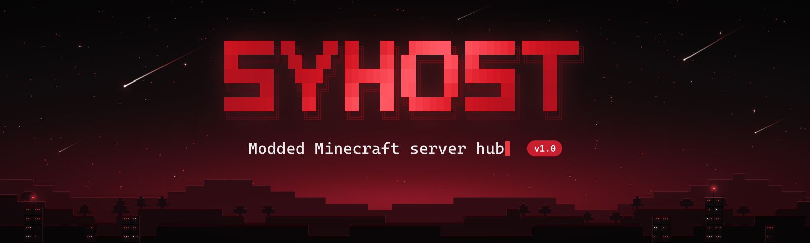
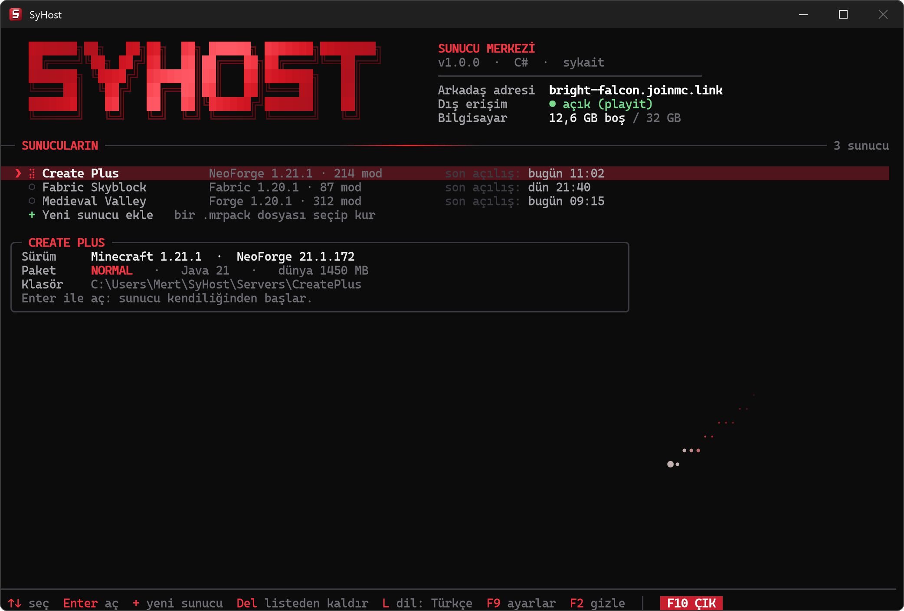
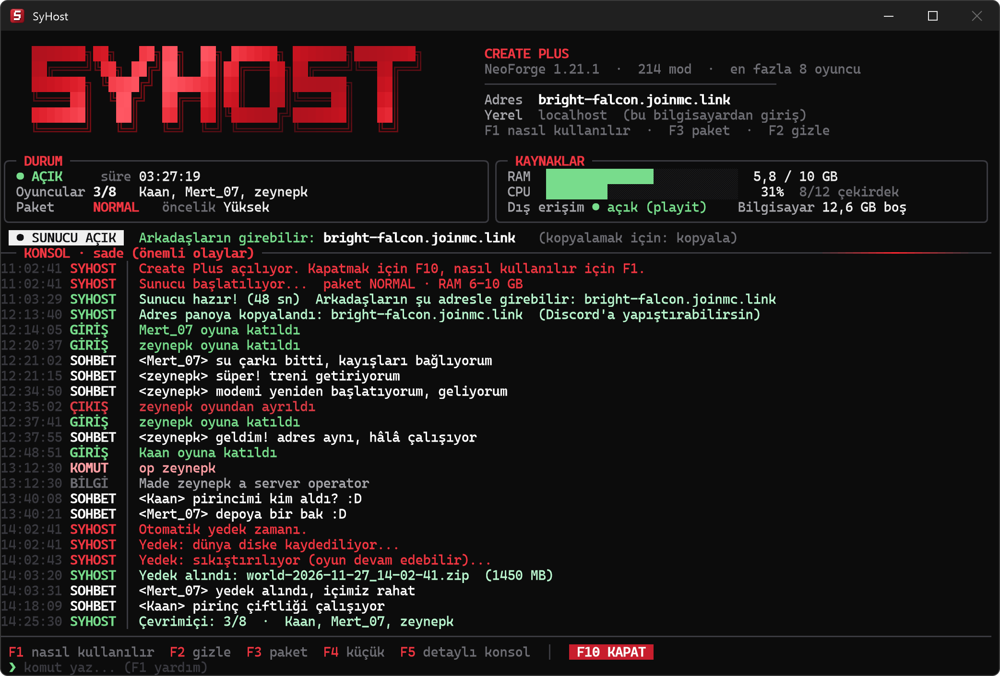
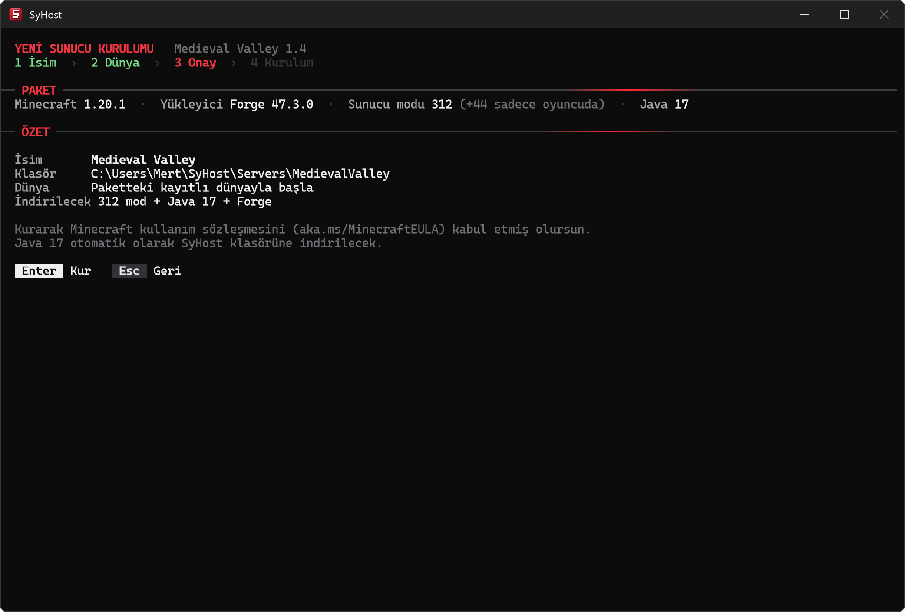
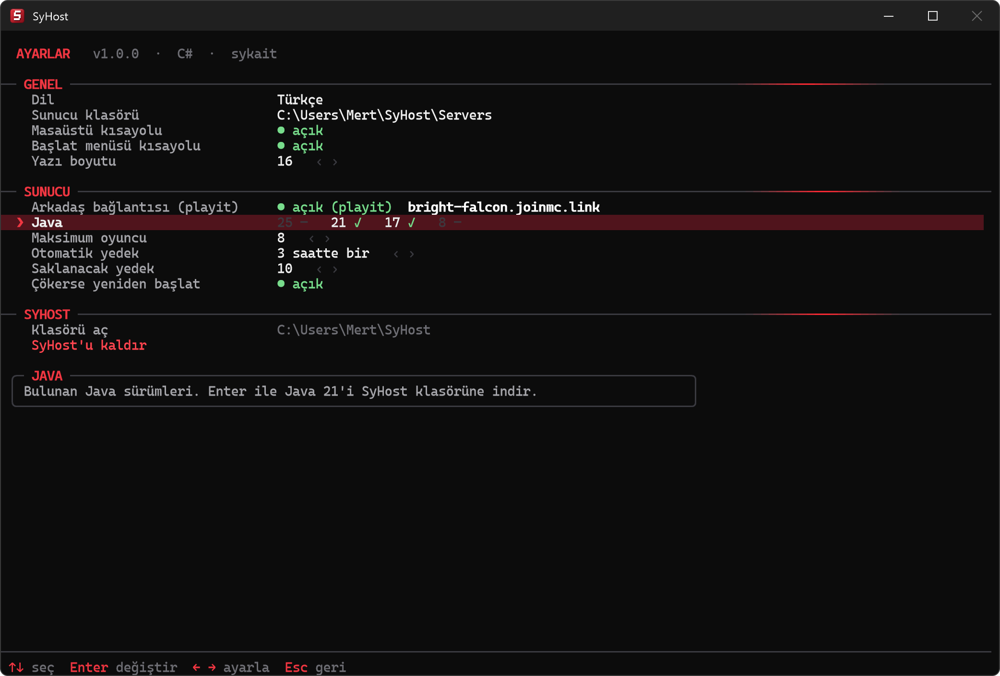
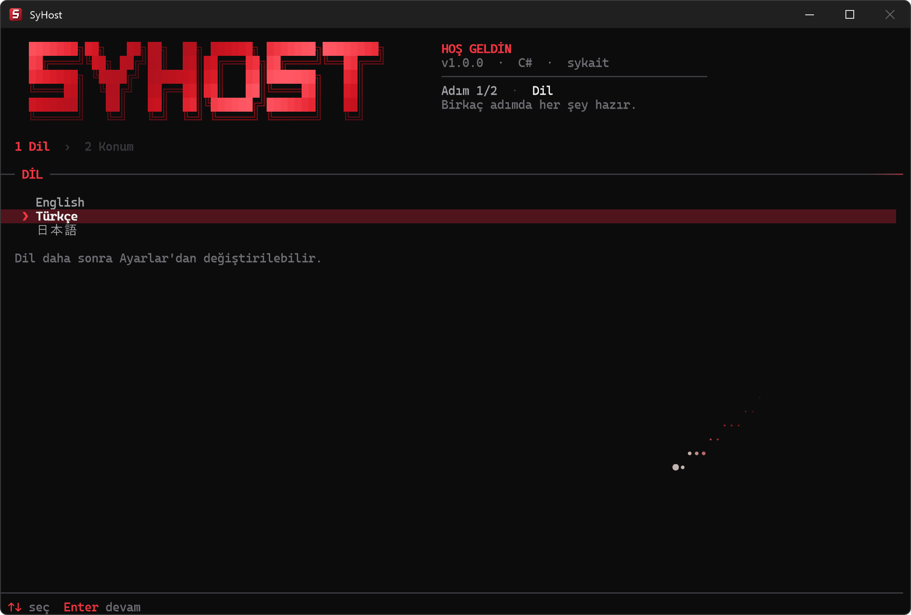
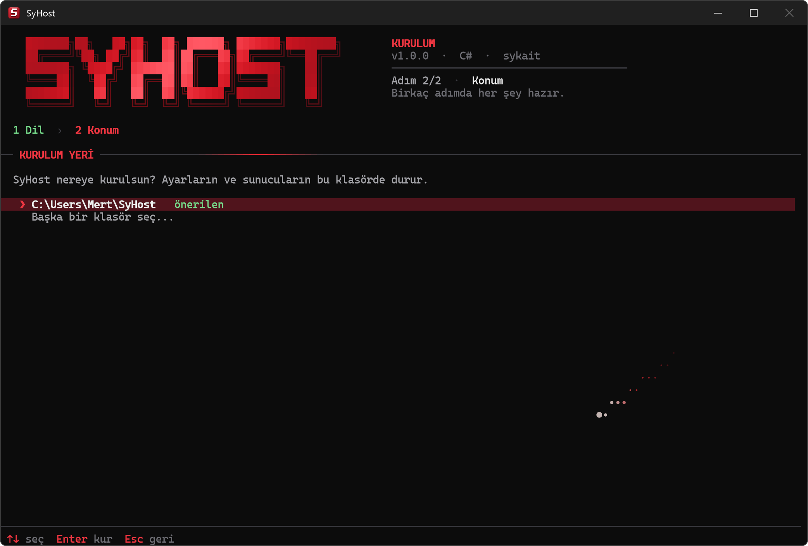
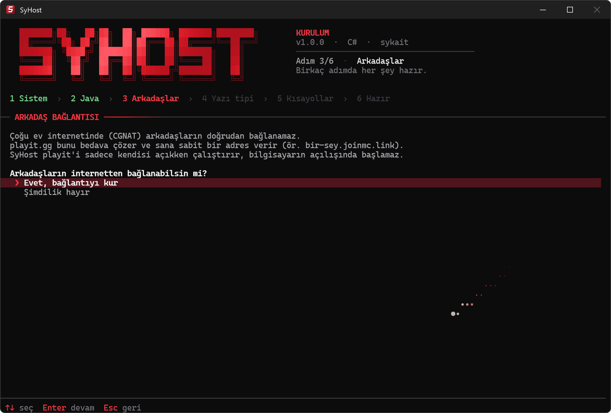
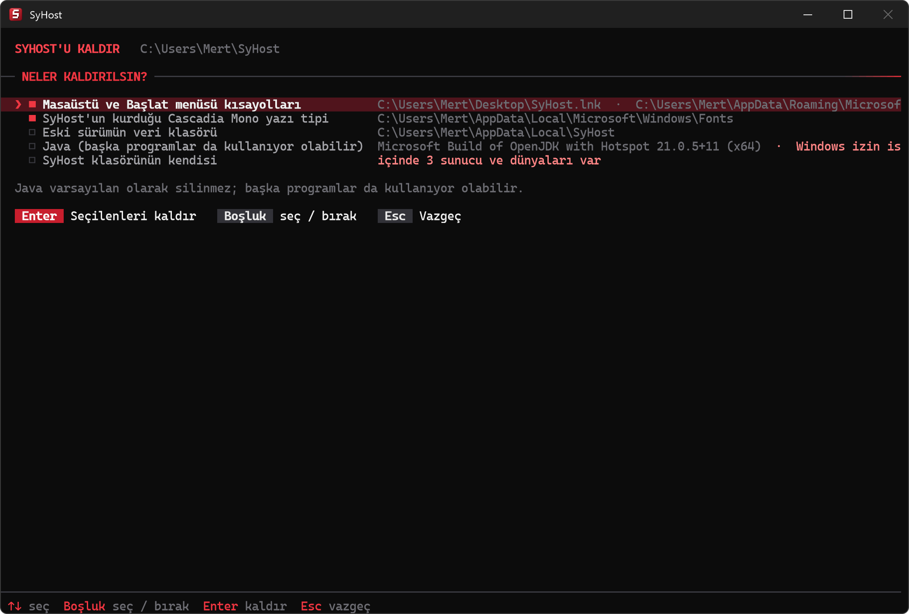
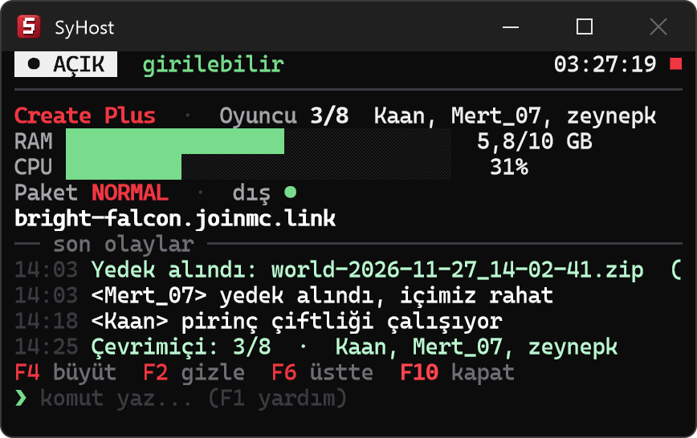

<p align="center">
  
</p>

<p align="center">
  <a href="../README.md">English</a> · <b>Türkçe</b> · <a href="README.ja.md">日本語</a>
</p>

# SyHost

**Modlu Minecraft sunucunu tek bir pencereden kur, aç, yönet.**
Modrinth'ten bir modpack (`.mrpack`) seç, gerisini SyHost halletsin: doğru Java, mod yükleyici, sunucuda çalışan
modlar, paketin ayarları, hatta paketle gelen hazır dünya. Sonra Enter'la sunucuyu aç, kimlerin oyunda olduğunu gör,
arkadaşların internetten bağlansın, yedeklerin kendiliğinden alınsın. Hepsi tek bir animasyonlu terminal ekranında.

> Windows 10 / 11 · NeoForge · Forge · Fabric · English, Türkçe, 日本語 · Yapımcı: [**sykait**](https://github.com/sykait)



## İçindekiler

[Neler yapar?](#neler-yapar) · [Ekran görüntüleri](#ekran-goruntuleri) · [İndir](#indir) · [İlk açılış](#ilk-acilis) ·
[SyHost klasörü](#syhost-klasoru) · [İlk sunucun](#ilk-sunucun) · [Sunucu ekranı](#sunucu-ekrani) ·
[Arkadaşların internetten](#arkadaslar) · [Java](#java) · [Yedekler](#yedekler) · [Ayarlar](#ayarlar) ·
[Güncelleme](#guncelleme) · [Kaldırma](#kaldirma) · [0.5.0'dan geçiş](#gecis) ·
[Güvenlik ve virüs tarayıcıları](#guvenlik) · [Sık sorulanlar](#sss) · [Kaynaktan derleme](#derleme) ·
[Proje düzeni](#proje-duzeni)

---

<a id="neler-yapar"></a>
## Neler yapar?

- **Tek dosya, kurulum derdi yok.** `SyHost.exe` seçtiğin bir klasöre kendini yerleştirir ve her şeyi orada tutar.
- **Birkaç tuşla modpack'ten sunucu.** [Modrinth](https://modrinth.com/modpacks)'teki NeoForge, Forge ve Fabric paketleri.
  Bilgisayarında doğru Java sürümü yoksa SyHost indirir.
- **Arkadaşların internetten bağlanır:** [playit.gg](https://playit.gg) ile bedava, sabit bir adres. playit yalnızca
  SyHost açıkken çalışır.
- **Canlı durum:** oyuncular, açık kalma süresi, RAM ve CPU; girişleri, sohbeti ve hataları gösteren sade bir konsol
  (F5 ile tüm kayıtlar).
- **Performans paketleri** (Düşük / Normal / Yüksek): SyHost ilk açılışta bunları bilgisayarının belleğine ve
  çekirdek sayısına göre ayarlar.
- **Otomatik yedek:** sunucu açıkken 3 saatte bir; en yeni 10 yedek saklanır.
- **Güvenli kapatma:** F10 → Enter oyunculara haber verir, dünyayı kaydeder, sunucuyu kapatır. Sunucu açıkken pencere
  kapansa bile sunucu kaydı bitirip öyle kapanır. Ondan sonra arkada hiçbir şey çalışmaz.
- **Küçük mod** ekranın köşesinde (F4 ya da Ctrl+Alt+K), **gizle / göster** her yerden (Ctrl+Alt+G), saatin yanında simge.
- **Ayarlar ekranı** (F9) ve uygulamanın içinden **kaldırma**.
- **Üç dil:** English, Türkçe, 日本語.

<a id="ekran-goruntuleri"></a>
## Ekran görüntüleri



<table>
  <tr>
    <td width="50%"><br><sub>Sunucu ekleme: kurmadan önceki özet</sub></td>
    <td width="50%"><br><sub>Ayarlar (F9)</sub></td>
  </tr>
  <tr>
    <td><br><sub>İlk açılış: dil</sub></td>
    <td><br><sub>İlk açılış: SyHost'un duracağı yer</sub></td>
  </tr>
  <tr>
    <td><br><sub>Kurulum: arkadaş bağlantısı</sub></td>
    <td><br><sub>Kaldır: neyin silineceğini sen seçersin</sub></td>
  </tr>
</table>

---

<a id="indir"></a>
## İndir

**[Releases sayfasından](https://github.com/sykait/SyHost/releases/latest)** indir:

| Dosya | Kimin için |
| --- | --- |
| **`SyHost-1.0.0.exe`** | **Herkes için (önerilen).** C# ile yazılmış ana sürüm. |
| `SyHost-Terminal-1.0.0.exe` | Aynı uygulamanın PowerShell sürümü (Windows'la birlikte gelen PowerShell'de çalışır). Betikleri okuyabilmek isteyenler için. |

İki sürüm de aynı görünür ve aynı çalışır; ekrandaki sürüm satırında yalnızca `C#` ya da `Terminal` yazar. İkisi de
aynı klasörde aynı dosyaları kullanır, istersen sonra öbürüne geçebilirsin. Her biri tek bir dosyadır, başka hiçbir
şey indirmen gerekmez. İki dosyanın SHA-256 sağlama toplamları sürüm notlarının sonundadır.

**Gerekenler:** 64 bit (x64) Windows 10 ya da 11 ve indirmeler için internet. Modlu sunucular belleği sever:
en az 8 GB RAM önerilir.

### "Windows bilgisayarınızı korudu"

SyHost dijital olarak imzalı değil; bu yüzden ilk açılışta Windows SmartScreen onu durdurabilir.
**Ek bilgi → Yine de çalıştır**'a tıkla. Tarayıcın da dosyayı saklamak isteyip istemediğini sorabilir. SyHost'un
bilgisayarında ne yaptığını ve bir güvenlik programı onu işaretlerse ne yapman gerektiğini
[Güvenlik ve virüs tarayıcıları](#guvenlik) bölümünde bulabilirsin.

---

<a id="ilk-acilis"></a>
## İlk açılış

İndirdiğin dosyaya çift tıkla.

 

1. **Dil.** Windows'un dili seçili gelir (Türkçe ve Japonca Windows'ta kendi dili, diğerlerinde İngilizce).
   Sonra istediğin zaman değiştirebilirsin.
2. **SyHost'un duracağı yer.** SyHost `C:\Users\<ad>\SyHost` klasörünü önerir. **Başka bir klasör seç...** ile
   yazabildiğin herhangi bir klasörü seçebilirsin; içinde başka dosyalar varsa SyHost oraya bir `SyHost` klasörü açar.
   Klasörün adı zaten `SyHost` ise ya da içinde kurulu bir SyHost varsa doğrudan o klasör kullanılır (oradaki SyHost
   güncellenir; daha yeniyse yalnızca açılır).
   - **OneDrive** ile eşitlenen bir klasör seçersen uyarı çıkar: sunucu dosyaları büyüktür ve sürekli değişir, bu yüzden
     OneDrive dışında bir yer önerilir. Yine de orada istiyorsan bir kez daha Enter'a bas.
   - Yazılamayan klasörler (ör. `Program Files`) kabul edilmez.
   - **Kendi klasöründe:** indirdiğin dosya boş bir klasörde tek başınaysa (İndirilenler, Masaüstü, Belgeler ya da geçici
     bir klasör değilse) SyHost yer sormaz, doğrudan oraya kurulur. Bu bilgisayardaki bir kısayol başka bir SyHost'u
     açıyorsa yine sorar; istersen onu güncellersin.
   - Bir zip ya da rar dosyasının içinden doğrudan açarsan SyHost nereye kurulacağını sorar.
3. SyHost kendini o klasöre kopyalar ve oradan yeniden açılır; indirdiğin dosyaya artık gerek kalmaz. (Kendi
   klasöründe kendini kopyalamaz, indirdiğin dosyanın adını `SyHost.exe` yapar.)
4. Ardından kısa bir kurulum gelir: **Sistem → Java → Arkadaşlar → Yazı tipi → Kısayollar → Hazır.**
   - **Sistem**: Windows sürümünü, RAM'i ve çekirdek sayısını gösterir (8 GB'tan az RAM'de uyarır).
   - **Java**: bilgisayarında Java 21 yoksa şimdi indir (yaklaşık 50 MB, yalnızca SyHost klasörüne) ya da sonra,
     sunucu eklerken insin.
   - **Arkadaşlar**: arkadaşların için bağlantıyı kur ([aşağıda](#arkadaslar)) ya da şimdilik geç.
   - **Yazı tipi**: Cascadia Mono yoksa SyHost onu yalnızca senin Windows kullanıcına kurar (yönetici izni gerekmez);
     logo ve animasyonlar böylece düzgün görünür.
   - **Kısayollar**: Masaüstüne ve Başlat menüsüne, ikisi de isteğe bağlı.

Daha önce SyHost 0.5.0 kullandıysan en başta bir **Eski veriler** adımı gelir: [0.5.0'dan geçiş](#gecis).
Kurulumu yarıda bırakıp SyHost'u kapatırsan bir sonraki açılışta kurulum yeniden karşına çıkar.

<a id="syhost-klasoru"></a>
## SyHost klasörü

```
C:\Users\<ad>\SyHost\
├── SyHost.exe      uygulama: açman gereken tek dosya
├── Servers\        sunucuların, her biri kendi klasöründe
├── Data\           ayarlar, sunucu listesi, playit anahtarı, kayıtlar, indirilen Java ve playit
└── App\            (yalnızca Terminal sürümü) PowerShell uygulaması
```

- **Her şey bu klasörde durur.** Klasörün dışına SyHost yalnızca kısayolları ve (kurmak zorunda kaldıysa) yazı tipini
  ekler, başka hiçbir şey. Başka bir yerde tuttuğun sunucular olduğu yerde kalır.
- **Taşınabilir.** Klasörü istediğin zaman taşıyabilir ya da adını değiştirebilirsin (önce SyHost'u kapat). Yeni
  yerindeki `SyHost.exe`'yi bir kez açman yeter: Masaüstü ve Başlat menüsü kısayollarını kendisi düzeltir. Klasörün
  içindeki sunucular onunla birlikte taşınır. Klasörü yazabildiğin bir yerde tut: `Program Files` gibi bir yerden
  açılırsa SyHost yalnızca bir uyarı gösterir ve SyHost klasörünü bütünüyle (`Servers` ve `Data` ile birlikte)
  taşımanı söyler.
- Explorer'da klasörler SyHost simgeleriyle görünür; `Servers` ve yedek klasörleri seçtiğin dilde adlandırılır
  (Türkçede `Sunucular` ve `Yedekler`).
- `Data\playit.toml` playit bağlantının gizli anahtarıdır. Kimseyle paylaşma.

<a id="ilk-sunucun"></a>
## İlk sunucun

1. [Modrinth](https://modrinth.com/modpacks)'ten bir modpack'i **`.mrpack`** dosyası olarak indir.
2. Ana menüde **Yeni sunucu ekle**'yi seç (ya da `+` tuşuna bas) ve dosyayı seç.
3. Sunucuya bir isim ver. Pakette hazır bir dünya varsa onunla mı, yepyeni bir dünyayla mı başlayacağını seç.
4. Özete bakıp **Enter**'a bas. Kurarak [Minecraft kullanım sözleşmesini](https://aka.ms/MinecraftEULA) kabul etmiş
   olursun; SyHost bunu özette yazar.
5. SyHost şimdi:
   - sunucu klasörünü açar (Ayarlar'da başka bir sunucu klasörü seçmediysen `Servers` içinde),
   - bu paketin istediği Java bilgisayarında yoksa indirir ([ayrıntı](#java)),
   - NeoForge'u ya da Forge'u kendi resmî kurulum programıyla kurar, Fabric'te Fabric'in sunucu başlatıcısını indirir,
   - sunucuda çalışan modları indirir (yalnızca oyuncuda çalışanları atlar) ve her dosyayı paketteki sağlama
     toplamlarıyla doğrular,
   - paketin ayar dosyalarını ve seçtiysen dünyasını kopyalar,
   - `server.properties` dosyasını yazar (port 25565, Ayarlar'daki maksimum oyuncu sayısı) ve paket kendi simgesini
     getirmediyse Minecraft'ın sunucu listesinde görünecek SyHost simgesini ekler.
6. **Enter**'a basınca sunucu açılır. Üstteki şeritte **SUNUCU AÇIK** yazınca hazırdır.

NeoForge, Forge ve Fabric paketleri desteklenir. Quilt paketleri henüz desteklenmiyor.

<a id="sunucu-ekrani"></a>
## Sunucu ekranı

Üstte sunucunun durumu, oyuncular, açık performans paketi, sunucunun kullandığı RAM ve CPU, arkadaşlarının sana
ulaşıp ulaşamadığı ve bilgisayarındaki boş bellek görünür. Altındaki şeritte **SUNUCU AÇIK** yazar ve arkadaş adresin
durur. Konsol yalnızca önemli olayları gösterir (girişler, çıkışlar, sohbet, hatalar ve SyHost'un kendi mesajları);
**F5** tüm teknik kayıtlara geçer. Komutları en alttaki satıra yazarsın.

### Tuşlar

| Tuş | Ne yapar |
| --- | --- |
| **↑ ↓**, **Enter** | Ana menü: sunucu seç ve aç (sunucu kendiliğinden başlar) |
| **+** | Ana menü: yeni sunucu ekle |
| **Del** | Ana menü: sunucuyu listeden kaldır (dosyaları diskte kalır) |
| **L** | Ana menü: dili değiştir |
| **F9** | Ana menü: ayarlar |
| **F1** | Sunucu: nasıl kullanılır (yardım) |
| **F2** | Pencereyi gizle; sunucu çalışmaya devam eder |
| **F3** | Sunucu: performans paketi seç |
| **F4** | Sunucu: köşedeki küçük mod / büyük mod |
| **F5** | Sunucu: sade / detaylı konsol |
| **F6** | Sunucu: küçük pencereyi diğer pencerelerin üstüne sabitle / sabitlemeyi kaldır (başta sabittir) |
| **F10** | Ana menü: çık. Sunucu: kapat (aşağıya bak) |
| **Ctrl+Alt+K** | Küçük / büyük mod, her yerden, oyundayken bile (bir sunucu açıkken) |
| **Ctrl+Alt+G** | SyHost'u gizle / göster, her yerden |
| **PgUp PgDn Home End** | Sunucu: konsolda yukarı aşağı git |
| **↑ ↓**, **Tab** | Sunucu: önceki komutlar; komut ve oyuncu adlarını tamamla |

**Kapatmak.** Sunucu ekranında F10 ne yapmak istediğini sorar: **Enter** oyunculara haber verir, dünyayı kaydeder,
sunucuyu kapatır ve ana menüye döner; **K** aynısını yapıp SyHost'u da kapatır; **Esc** vazgeçer. Sunucu 60 saniye
içinde kapanmazsa SyHost onu zorla kapatır. Sunucu açıkken pencere başka bir yoldan kapanırsa (görev çubuğundan ya da
oturumu kapattığın için) SyHost sunucuya yine de kapanmasını söyler; sunucu dünyayı kaydetmeyi kendi kendine bitirir.

**Küçük mod** (F4) ekranın köşesinde duran küçük bir penceredir: durum, oyuncular, RAM ve CPU, son olaylar. Diğer
pencerelerin üstüne sabitlenmiş gelir, oyun oynarken de görünür; F6 sabitlemeyi kaldırır ve yeniden sabitler.



**Gizle** (F2) SyHost'u ekrandan kaldırır, sunucu çalışmaya devam eder. Ctrl+Alt+G ya da saatin yanındaki simge onu
geri getirir. Simgenin menüsünden sunucuyu yeniden başlatabilir ya da SyHost'u kapatabilirsin.

**Sunucu çökerse** SyHost onu 10 saniye sonra yeniden açar (Ayarlar → Çökerse yeniden başlat). 10 dakika içinde üç kez
çökerse denemeyi bırakır; F5 ile ayrıntılara bakabilirsin.

### Komutlar

Sunucu ekranında yaz ve Enter'a bas:

| Komut | Ne yapar |
| --- | --- |
| `baslat` · `durdur` · `yeniden` | Sunucuyu aç, kapat ya da yeniden başlat |
| `paket dusuk` · `paket normal` · `paket yuksek` | Performans paketini değiştir (yalnızca `paket` seçim ekranını açar) |
| `yedek` | Dünyanın yedeğini şimdi al |
| `oyuncular` | Kimler oyunda |
| `adres` · `kopyala` | Adresleri göster / arkadaş adresini panoya kopyala |
| `klasor` | Sunucu klasörünü aç |
| `detay` · `sade` | Detaylı ya da sade konsol |
| `kucuk` · `buyuk` · `ustte` · `gizle` | Pencere modları (F4, F6, F2 gibi) |
| `temizle` | Konsolu temizle |
| `zorla` | Yanıt vermeyen sunucuyu kapat |
| `menu` · `cikis` | Ana menüye dön / SyHost'u kapat (sunucu güvenle kapanır) |

Bunların dışında yazdığın her şey doğrudan Minecraft'a gider: `op isim`, `kick isim`, `say merhaba`, `time set day`…
İngilizce komutlar da çalışır: `start`, `stop`, `backup`…

**Performans paketleri** (F3) sunucunun ne kadar RAM, kaç çekirdek ve hangi öncelikle çalışacağını belirler: kendin ağır
bir oyun oynarken **Düşük**, günlük kullanımda **Normal**, dev fabrikalar ve hızlı keşif için **Yüksek**. Çekirdek ve
öncelik hemen değişir; yeni RAM ayarı için `yeniden` yaz.

---

<a id="arkadaslar"></a>
## Arkadaşların internetten bağlansın (playit.gg)


Çoğu ev internetinde (CGNAT) arkadaşların bilgisayarına doğrudan bağlanamaz. [playit.gg](https://playit.gg) bunu bedava
çözer ve sana `bir-sey.joinmc.link` gibi sabit bir adres verir.

**Kurmak için** ilk açılıştaki **Arkadaşlar** adımını ya da sonra **Ayarlar → Arkadaş bağlantısı (playit)**'i kullan:

1. SyHost playit'i kendi klasörüne indirir (`Data\tools\playit`). SyHost 0.5.0'ın playit'i hâlâ `Program Files`'ta
   duruyorsa onun yerine o kullanılır.
2. Tarayıcında playit.gg açılır: hesabın yoksa bedava oluştur, varsa giriş yap, sonra bu bilgisayarı onayla.
3. playit'in tünel sayfası açılır: **Add Tunnel → Minecraft Java → Continue →** bölge **Automatic (Free) → Create Tunnel**.
   Simple Voice Chat modunu kullanıyorsan bir de **MC: Simple Voice Chat** tüneli oluştur.
4. Adresleri SyHost'a yapıştır. Sesli sohbet adresini SyHost modun ayarlarına kendisi yazar.

**playit yalnızca SyHost açıkken çalışır.** SyHost onu kendisiyle birlikte açar ve kapatır. Bir Windows hizmeti
değildir, bilgisayar açılırken başlamaz.

**Arkadaşını çağırmak için** sunucu ekranında `kopyala` yaz ve adresi Discord'a yapıştır. Arkadaşın **aynı modpack'in
aynı sürümünü** açar (Modrinth App, Prism Launcher…), **Çok Oyunculu → Sunucu Ekle**'ye gider ve adresi yapıştırır.

playit olmadan da kendi bilgisayarından `localhost` ile girebilirsin; aynı evdeki ağda olanlar da bilgisayarının yerel IP
adresiyle bağlanabilir. İnternetin gerçek (public) bir IP alıyorsa ve TCP 25565 portunu bilgisayarına
yönlendirirsen playit'e yine gerek kalmaz.

<a id="java"></a>
## Java

- SyHost önce bilgisayarında zaten kurulu bir Java arar (`Program Files` içindeki Microsoft Build of OpenJDK ya da
  Eclipse Temurin).
- Sunucu eklerken doğru sürüm yoksa **Eclipse Temurin**'i (Adoptium'dan) SyHost klasöründeki `Data\tools\java-<sürüm>`
  içine indirir. Adoptium'un SHA-256 sağlama toplamı alınabildiyse indirileni onunla doğrular; her durumda o Java'yı
  kullanmadan önce `java -version` çalışıyor mu diye bakar. Kurulum programı yok, yönetici izni yok, klasörün dışına
  hiçbir şey.
- Her sunucu kendi Minecraft sürümünün istediği Java'yı kullanır: 1.20.5 ve sonrası → Java 21, 1.17 ile 1.20.4 arası → 17,
  daha eskiler → 8, Minecraft 26.x → 25.
- **Ayarlar → Java** SyHost'un kullanabildiği sürümleri gösterir, Enter'la Java 21'i indirir.

<a id="yedekler"></a>
## Yedekler

- **Otomatik:** sunucu açıkken 3 saatte bir (Ayarlar → Otomatik yedek: 1 ile 24 saat arası, 0 = kapalı).
- **İstediğin an:** `yedek` yaz.
- Dünya önce diske kaydedilir, sonra sen oynamaya devam ederken sıkıştırılır:
  `<sunucu klasörü>\yedekler\world-2026-11-27_14-02-41.zip`.
- Yalnızca en yeni **10** yedek saklanır (Ayarlar → Saklanacak yedek).
- Bir yedeği geri yüklemek için: sunucuyu kapat, `world` klasörünün adını değiştir, boş bir `world` klasörü aç ve
  yedeği onun içine çıkar.

<a id="ayarlar"></a>
## Ayarlar

Ana menüde **F9**'a bas. Her değişiklik hemen kaydedilir.

| Ayar | Ne yapar |
| --- | --- |
| Dil | English, Türkçe ya da 日本語. Explorer'daki klasör adları da ona uyar |
| Sunucu klasörü | Yeni sunucuların kurulacağı yer (varsayılan: SyHost klasöründeki `Servers`) |
| Masaüstü kısayolu · Başlat menüsü kısayolu | Açık ya da kapalı |
| Yazı boyutu | Yazının boyu; pencere ona göre büyür ya da küçülür |
| Arkadaş bağlantısı (playit) | Arkadaş bağlantısını kur ya da yeniden bağla |
| Java | SyHost'un bulduğu Java sürümleri; Enter Java 21'i SyHost klasörüne indirir |
| Maksimum oyuncu | Bundan sonra kurulan sunucular için |
| Otomatik yedek · Saklanacak yedek | Kaç saatte bir (0 = kapalı) ve kaç tane |
| Çökerse yeniden başlat | Açık ya da kapalı |
| Klasörü aç | SyHost klasörünü Explorer'da açar |
| SyHost'u kaldır | Bkz. [Kaldırma](#kaldirma) |

<a id="guncelleme"></a>
## Güncelleme

1. Yeni SyHost'u [Releases sayfasından](https://github.com/sykait/SyHost/releases/latest) indir.
2. SyHost açıksa kapat.
3. Yeni dosyayı aç. Klasör adımında SyHost klasörünü seç: SyHost kısayollarının açtığı klasörü kendisi önerir
   (**Bilgisayardaki SyHost'u güncelle**) ve "Burada zaten SyHost var; güncellenip açılacak." der.
4. SyHost o klasördeki `SyHost.exe`'yi yenisiyle değiştirir ve açar. Sunucuların, dünyaların, ayarların, Java ve playit
   bağlantın olduğu gibi kalır.

**Bilgisayardaki SyHost'u güncelle**'yi seçtiğinde oradaki SyHost zaten daha yeniyse yalnızca açılır, değiştirilmez.

<a id="kaldirma"></a>
## Kaldırma


**Ayarlar → SyHost'u kaldır**'ı aç. SyHost (ya da SyHost 0.5.0) klasörün **dışında** ne bıraktıysa her biri ayrı bir
satırda listelenir; **Boşluk** tuşuyla sen seçersin:

- Masaüstü ve Başlat menüsü kısayolları ve (SyHost kurduysa) senin kullanıcına kurduğu yazı tipi. Bunlar seçili gelir.
- SyHost 0.5.0'ın bilgisayarda bıraktıkları: eski veri klasörü, eski program klasörü, `Program Files`'taki playit,
  Windows'a kurulan yazı tipi ve bilgisayarda kurulu Java (Microsoft OpenJDK ve Eclipse Temurin 8; 0.5.0 bunları böyle
  kurmuştu). Bunların hiçbiri seçili gelmez.
  **Java hiçbir zaman kendiliğinden seçilmez**, çünkü başka programlar da kullanıyor olabilir. "Windows izin isteyecek"
  yazan satırlar yönetici izni ister. Yeni SyHost bu playit'i, yazı tipini ve Java'yı durdukları sürece kullanmaya
  devam eder: silmeden önce [0.5.0'dan geçiş](#gecis) bölümünü oku.
- **SyHost klasörünün kendisi**, içindeki sunucular ve dünyalarla birlikte. Satırında onunla birlikte kaç sunucunun
  gideceği yazar: `Servers` içindeki her klasör sayılır, listeden kaldırdığın sunucular da. Seçili gelmez; seçersen
  SyHost bir kez daha Enter'a basmanı ister. SyHost kapanırken klasörün içindeki her şeyi kendisi siler, sonra klasörü
  Explorer'da gösterir: kalanı (çalışırken kendini silemeyen SyHost.exe'yi) oradan silersin.

**Enter** seçilenleri kaldırır. Son ekranda yalnızca **SyHost'u kapat** vardır, yani SyHost en sonunda kapanır.
Klasörü tutarsan SyHost işi bitince onu Explorer'da gösterir; istediğin zaman kendin silebilirsin (hiçbir şey seçmeden
Enter'a basarsan doğrudan o ekrana geçilir). SyHost klasörünün dışındaki sunuculara asla dokunulmaz.

<a id="gecis"></a>
## 0.5.0'dan geçiş

- Yeni SyHost'u indirip [İlk açılış](#ilk-acilis)'taki gibi aç. Eski tek satırlık PowerShell kurulumu artık kullanılmıyor.
- SyHost 0.5.0 verilerini `%LOCALAPPDATA%\SyHost` içinde tutuyordu. Yeni SyHost kendi klasöründe ilk kez açıldığında
  ayarlarını, sunucu listeni ve playit bağlantını kendi `Data` klasörüne **bir kez kopyalar**.
- **Eski klasör silinmez.** SyHost içine kısa bir not bırakır. Sonra istersen Ayarlar → SyHost'u kaldır →
  *Eski sürümün veri klasörü* ile silebilirsin. O ekranda Masaüstü ve Başlat menüsü kısayolları (SyHost kendi yazı
  tipini kurduysa o da) seçili gelir: yalnızca 0.5.0'dan kalanları temizlemek istiyorsan önce bu satırların seçimini
  Boşluk ile kaldır. Enter seçilenleri kaldırır, en sonunda da SyHost kapanır (**SyHost'u kapat**).
- **Sunucuların olduğu yerde kalır** (ör. `%USERPROFILE%\SyHost Sunuculari`) ve oradan çalışmaya devam eder. Yeni
  sunucular SyHost klasöründeki `Servers` içine kurulur; 0.5.0'da kendin başka bir sunucu klasörü seçtiysen o korunur
  (Ayarlar → Sunucu klasörü).
- **0.5.0'ın bilgisayara kurduklarını, durdukları sürece yeni SyHost da kullanır**; yani bunlar yalnızca eskiden kalan
  şeyler değildir:
  - `C:\Program Files\playit_gg` içindeki **playit**: SyHost'un `Data\tools\playit` içinde kendi playit'i olmadığı
    sürece o kullanılır. Silersen **Ayarlar → Arkadaş bağlantısı (playit)** ile playit'i yeniden bağla; SyHost da
    playit'i kendi klasörüne indirir.
  - `Program Files` içindeki **Java**: silersen, onu kullanan sunucular SyHost o Java'yı kendi klasörüne indirene kadar
    açılmaz (SyHost ör. "Java 21 bulunamadı" der). **Ayarlar → Java** Java 21'i indirir; sunucu eklemek de paketin
    istediği Java'yı SyHost klasörüne indirir.
  - `C:\Windows\Fonts` içindeki **Cascadia Mono yazı tipi**: SyHost kendi kopyasını senin kullanıcına yalnızca kurulum
    sırasında kurar; bunu sonradan silersen logo ve animasyonlar düzgün görünmeyebilir.
- Kısayollar adımı eski kısayolları yeni SyHost'u açanlarla değiştirir.
- Sonra başka, ayrı bir SyHost kopyası açarsan eski verileri yeniden kopyalamadan önce sorar (aynı playit bağlantısını
  kullanan iki kopya birbirini bozar).

---

<a id="guvenlik"></a>
## Güvenlik ve virüs tarayıcıları

SyHost sıradan bir programdır ve öyle davranmaya çalışır:

- Yalnızca kendi klasöründe çalışır. Yönetici iznini yalnızca eski 0.5.0 kurulumunun bütün bilgisayara kurduğu bir
  şeyi kaldırmayı seçtiğinde ister (Ayarlar → SyHost'u kaldır): yazı tipi için Windows izin penceresinde SyHost'un
  kendisi görünür, playit ve Java için onların kendi Windows Installer'ı.
- Hiçbir zaman gizli ya da kodlanmış komut çalıştırmaz, çalışırken metinden kod üretmez, dosyalardaki "internetten
  indirildi" işaretini silmez ve kendini yardımcı bir programla silmez. Kaldırırken klasörün içini SyHost açıkken
  boşaltır; boş kalan klasörü Explorer'dan sen silersin.
- Yalnızca şuralardan indirir: Adoptium (Java), GitHub (playit), Modrinth ve mod yükleyicilerinin kendi sunucuları
  (NeoForge, Forge, Fabric). Java ve modlar sağlama toplamlarıyla denetlenir. playit yalnızca dosyası GitHub'ın verdiği
  sağlama toplamıyla tutuyorsa ve yayıncısının geçerli imzasını taşıyorsa çalıştırılır.
- Windows açılınca hiçbir şey başlamaz. playit yalnızca SyHost açıkken çalışır.

SyHost henüz dijital olarak imzalı değil; bu yüzden SmartScreen ilk açılışta uyarabilir ve bir güvenlik programı hiç
görmediği bir dosyaya karşı fazladan temkinli olabilir. Seninki SyHost'u işaretlerse:

1. Dosyanın gerçek olduğunu denetle: SHA-256 değeri sürüm notlarının sonundakiyle aynı olmalı
   (PowerShell'de: `Get-FileHash .\SyHost-1.0.0.exe`).
2. Üreticisine yanlış tespit olarak bildir. Microsoft Defender için:
   [microsoft.com/wdsi/filesubmission](https://www.microsoft.com/wdsi/filesubmission) ("yanlış algılandı").
3. Başkaları da bilsin diye GitHub'da bir issue aç.

Virüs tarayıcını kapatma ve SyHost için dışlama ekleme.

Geliştiriciler için: `tests\av\Test-Lint.ps1` (CI'da çalışır), güvenlik programlarının kötü amaçlı yazılımla
ilişkilendirdiği bir kalıp geri gelirse hata verir; `tests\av\Test-Defender.ps1` sürüm çıkmadan önce betikleri ve iki
exe'yi bilgisayardaki Microsoft Defender ile denetler.

<a id="sss"></a>
## Sık sorulanlar

**playit şart mı?**
Hayır. playit olmadan kendi bilgisayarından (`localhost`) oynayabilirsin, aynı evdeki ağda olanlar da bağlanabilir.
Arkadaşların internetten bağlanacaksa ve internetin CGNAT arkasındaysa (Türkiye'de çok yaygın) playit gerekir.

**Bilgisayarımı yavaşlatır mı?**
SyHost'un kendisi çok hafiftir. Sunucu, performans paketinin izin verdiği kadarını kullanır (F3): ağır bir oyun
oynarken **Düşük**, diğer zamanlarda **Normal** seç.

**Aynı anda iki sunucu açabilir miyim?**
Hayır, bir seferde bir sunucu. Bir sunucu çalışırken SyHost ikincisini başlatmaz.

**Yönetici izni gerekir mi?**
Hayır. Java, playit ve yazı tipi senin kullanıcı alanına gider. Yalnızca eski 0.5.0 kurulumunun bütün bilgisayara
kurduklarını kaldırırken Windows izin ister.

**Dosyalarım nerede?**
SyHost klasöründe: sunucular `Servers` içinde (ya da Ayarlar'da seçtiğin sunucu klasöründe), geri kalan her şey
`Data` klasöründe, yedekler her sunucunun `yedekler` klasöründe. Ayarlar → Klasörü aç seni oraya götürür.

**Hangi modpack'ler çalışır?**
NeoForge, Forge ve Fabric için Modrinth `.mrpack` paketleri. Paketin istediği Java (8, 17, 21 ya da 25) bilgisayarında
yoksa indirilir.

**Hangi sürümü indirmeliyim?**
`SyHost-1.0.0.exe`'yi. Terminal sürümü, PowerShell betiklerini okumayı sevenler için aynı uygulamadır.

**Mac ya da Linux?**
Yalnızca Windows 10 ve 11.

---

<a id="derleme"></a>
## Kaynaktan derleme

Windows, [.NET 10 SDK](https://dotnet.microsoft.com/download) ve Visual Studio C++ derleme araçları (tek dosyalık
NativeAOT derlemesi için) gerekir; bir de Windows'la gelen Windows PowerShell 5.1.

```powershell
build\Build.ps1                       # hızlı derleme denetimi (Debug)
build\Build.ps1 -Publish              # dist\SyHost.exe: ana sürüm, tek dosya
build\Build.ps1 -Publish -Terminal    # ayrıca dist\SyHost-Terminal.exe: Terminal sürümü
tests\parity\Run-Parity.ps1           # derler, sonra iki sürümü ekran ekran karşılaştırır
build\Render-Screens.ps1              # docs\images\screens içindeki ekran görüntülerini yeniden çizer
```

**İki sürüm, tek ekran.** SyHost bir PowerShell betiği olarak başladı. **Ana sürüm** (`src/SyHost`) onun C#'a
aktarılmış hâlidir; .NET 10 NativeAOT ile tek bir `SyHost.exe` olarak derlenir ve ölçü odur. **Terminal sürümü**
(`legacy/src`) aynı özelliklere kavuşturulmuş PowerShell uygulamasıdır; başlatıcı exe'si betikleri içinde taşır.

**Eşlik (parity) testi** ikisini aynı tutar. `tests/parity/scenarios` içindeki her senaryo uygulamanın bir anını
anlatır: ekran, dil, sunucular, (dondurulmuş) saat, hatta basılacak tuşlar. İki sürüm de o anı renkleriyle birlikte
tek bir metin karesi olarak çizer (`SyHost.exe --frame` ve `SyHost.ps1 -TestFrame`) ve iki kare bayt bayt aynı olmak
zorundadır. CI bunu `main`'e yapılan her push'ta ve her pull request'te çalıştırır. Bu sayfadaki ekran görüntüleri de
böyle senaryolardan (`docs-*.json`) `build\Render-Screens.ps1` ile çizilir.

**Metinler** üç dillidir. Temel tablo `legacy/src/Lang.ps1` ve `src/SyHost/App/Lang.Table.cs` içindedir; ikisi elle aynı
tutulur. Yeni ekranların metinleri C# tarafında yazılır (`src/SyHost/App/Lang.Screens.cs`,
`src/SyHost/Setup/Lang.Portable.cs`, `src/SyHost/Core/Installer.cs`, `src/SyHost/Core/Tray.cs`) ve
`build\Sync-Lang.ps1` bunları `legacy/src/Lang.Screens.ps1` dosyasına kopyalar (`build\Sync-Lang.ps1 -Check` yalnızca
kopyanın güncel olup olmadığına bakar).

<a id="proje-duzeni"></a>
## Proje düzeni

```
SyHost/
├── src/
│   ├── SyHost/             ana sürüm (C#, .NET 10, NativeAOT)
│   │   ├── App/            ekranlar: ana menü, sunucu, yeni sunucu, ilk açılış, ayarlar, kaldır; metinler
│   │   ├── Core/           Windows katmanı, sunucu kurulumu, Java, tepsi simgesi, ayar dosyaları
│   │   ├── Setup/          SyHost klasörü, kısayollar, yazı tipi, eski verinin taşınması, kaldırma, klasör simgeleri
│   │   └── Assets/         uygulama ve klasör simgeleri
│   └── SyHost.Terminal/    Terminal sürümünün başlatıcısı (PowerShell uygulamasını içinde taşıyan tek exe)
├── legacy/                 Terminal sürümü (Windows PowerShell 5.1)
│   ├── src/                SyHost.ps1 ve parçaları, C# yardımcıları, metinler
│   ├── config/             varsayılan ayarlar (iki sürüm de kullanır)
│   └── fonts/              Cascadia Mono (SIL Open Font License 1.1)
├── build/                  Build.ps1, Sync-Lang.ps1, Render-Screens.ps1, Build-Banner.ps1, Build-Icons.ps1
├── tests/parity/           Run-Parity.ps1 ve senaryolar
├── docs/                   bu sayfa (Türkçe ve 日本語), resimler, sürüm notları
└── .github/workflows/      CI ve sürüm yayınlama
```

---

## Nasıl yapıldı

SyHost'un özelliklerini, akışını ve görünüşünü **sykait** tasarladı ve yönetti.
Kod, yapay zekâ kodlama araçlarıyla birlikte yazıldı.

## Lisans ve kredi

SyHost **kaynak görünür** bir projedir: kodu görebilir, indirebilir ve kişisel olarak kullanabilirsin.
**Bu projeyi kullanarak bir şey yapıp paylaşırsan kredi vermek zorunludur:**

> Bu proje **SyHost** (yapımcı: **sykait**) projesine dayanmaktadır — https://github.com/sykait/SyHost

Satış ve ticari kullanım yazılı izin olmadan yasaktır. Ayrıntılar: [LICENSE.md](../LICENSE.md).
Cascadia Mono yazı tipi SIL Open Font License 1.1 ile lisanslıdır ([legacy/fonts/OFL.txt](../legacy/fonts/OFL.txt)).

Minecraft, Mojang Studios'un ticari markasıdır. SyHost, Mojang veya Microsoft ile bağlantılı değildir.
